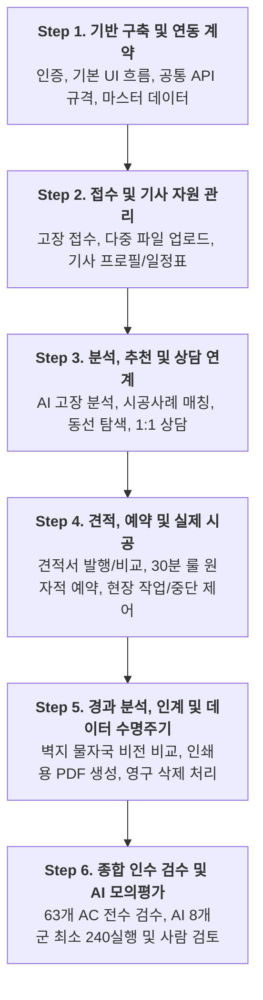

# 고쳐야집 FE·BE 분업 작업 명세

| 항목 | 내용 |
| :--- | :--- |
| **기준 문서** | [요구사항명세서 — 기능](요구사항명세서(기능들).md) v1.7 (개정일: 2026-11-08) |
| **작성일 / 개정일** | 2026-11-10 / 2026-11-11 |
| **문서 버전** | v1.4 |
| **개정 내용** | FE의 웹 브라우저 기반 구현과 BE의 서버 실행 환경 명시. 앱·인앱 표현을 웹 서비스 기준으로 정리 |
| **문서 목적** | 기능별 FE·BE 구현 책임 분담, 연동 데이터 규격, 선행 작업 의존성 및 공동 검수 기준 정의 |
| **적용 범위** | 사용자·기사용 웹 브라우저 화면(FE), 서버의 API·저장소·권한·일정 처리(BE), AI 파이프라인, 전달본·PDF 생성, 시연 데이터 및 종합 검수 |

> [!NOTE] 문서 개요 및 유의사항
> - 본 문서는 요구사항명세서 v1.7을 개발 작업 단위로 구체화한 작업 명세서입니다.
> - 기능의 포함·제외 여부와 서비스 기본 정책은 기준 문서(v1.7)를 엄격히 따릅니다.
> - `W01`~`W23`은 분업 작업 식별자이며, `FR`·`AC`는 기준 문서의 기능 요구사항 및 인수 시나리오 식별자입니다.
> - 구체적인 API 경로, 필드명, 내부 상태 코드, 라이브러리는 별도의 상세 연동 계약에서 확정합니다.
> - FastAPI(Python), PostgreSQL, OpenAI SDK는 사용 예정 기술 스택이며, 본 문서에서 확정 스택으로 변경하지 않습니다.
> - 제3.3절의 구현 기술은 상세 설계에서 선택할 후보입니다. 완료 여부는 특정 기술의 사용이 아니라 기준 문서의 기능·정합성·검수 조건 충족으로 판정합니다.

---

## 1. 분업 원칙과 구현 범위

### 1.1 공통 분업 원칙

FE는 **웹 브라우저에서 이용하는 웹 프론트엔드**로 구현합니다. 별도 설치형 모바일·데스크톱 앱 개발은 이번 구현 범위에 포함하지 않습니다. BE는 **서버에서 실행되는 백엔드**로 구현하며, FE에 API를 제공하고 데이터 저장·권한 검증·비즈니스 로직·AI 처리 등을 담당합니다.

| 구분 | 담당 작업 | 완료 산출물 |
| :--- | :--- | :--- |
| **FE (웹 프론트엔드)** | • 사용자 및 기사 전용 웹 화면 UI/UX 구현 • 입력·선택·확인 단계별 흐름 제어 • 파일 업로드 및 미리보기 • 처리 상태, 판단 근거, 실패 사유 표시 • 백엔드 API 연동 및 화면 내 캐시/데이터 동기화 | 정상·빈 결과·처리 중·실패·권한 없음 등 모든 상태가 반영된 웹 화면 컴포넌트 및 연동 결과물 |
| **BE (서버 백엔드)** | • 비즈니스 API 및 데이터 영속화(DB 저장) • 사용자 인증 및 관계별 세분화된 접근 권한 검증 • 파일 유효성 검증 및 비식별화 처리 • 상태 전이(State Machine), 버전 관리, 동시성 제어 • 일정 충돌 검증 알고리즘 및 AI 파이프라인 연계 • 전달본 및 PDF 생성, AI 모델 평가 환경 구축 | API 명세 및 서버 구현체, 데이터 저장소/처리 로직, 재현 가능한 비즈니스 규칙 검증 및 AI 평가 결과 |
| **공동 책임** | • 기능별 I/O 데이터 계약, 에러 코드 및 상태 정의 • 기능 시연 및 테스트용 기준 데이터셋 구축 • 화면 UI와 API의 동일 비즈니스 조건 준수 확인 • 인수 조건(AC) 기반의 종합 E2E 검수 수행 | 상호 합의된 API 계약 및 Mock/샘플 데이터, 사용자·기사 간 연결 시나리오 검증 결과서 |

#### 핵심 개발 가이드라인

1. **방어적 서버 검증**: FE의 버튼 비활성화나 입력값 검증은 사용자 편의를 위한 1차 처리입니다. BE는 직접 API 호출에 대해서도 소유권, 권한, 한도, 최신 데이터 정합성, 상태 전이 유효성을 독립적으로 재검증해야 합니다.
2. **서버 응답 기반 상태 확정**: 예약 확정, 작업 시작/완료 등 핵심 상태 전이는 반드시 서버 응답을 확인한 후 화면에 반영합니다. UI 차원의 중복 클릭 방지는 FE가, 중복 처리 및 경합 제어는 BE가 전담합니다.
3. **AI 결과의 초안 취급**: AI가 도출한 결과는 언제나 '초안'으로 취급합니다. 사용자 최종 확인 여부, 입력 데이터의 최신성, 외부에 공개 가능한 범위를 명확히 분리하여 관리합니다. 단순 조회나 데이터 수정만으로 유료 AI 재분석 API를 자동 호출하지 않습니다.
4. **엔티티 상태 독립성 보장**: 요청 전체, 개별 작업 항목, 상담 관계, 견적, 예약, 실제 작업의 상태를 엄격히 분리합니다. 특정 세부 항목의 완료나 종료가 다른 항목 또는 전체 요청을 자동으로 종료시키지 않습니다.
5. **목록 및 응답의 명확한 분리**: 공개 기사 목록, 사례 기반 추천, 일반 후보 탐색, 동선 추천은 각각 독립적인 기능입니다. 각 목록과 API 응답은 고유한 선정 근거, 권한 제약, 조건 충족 여부를 명시적으로 구분해야 합니다.

---

### 1.2 서비스 진입 경로별 처리

| 서비스 경로 | FE 구현 요구사항 | BE 구현 요구사항 |
| :--- | :--- | :--- |
| **일반·긴급 직접 연락** | • 비로그인 상태에서도 공개 기사 목록, 연락처, 검증된 긴급 대처 안내를 즉시 노출 • 분야·지역 필터는 선택 사항으로 제공 | • 기사가 직접 공개 동의한 필드만 조회 • 연락처 조회나 전화 연결 동작으로 인해 상담·예약·일정 점유·수리 완료 상태가 생성되지 않도록 분리 |
| **AI 진단 기반 웹 서비스 이용** | • 접수 → AI 문답 및 요약 초안 → 사용자 검토·확인 → 항목별 해결 경로(자가해결·상담·견적·예약)의 순차적 흐름 제공 | • AI 비동기 작업과 사용자 최종 확인 상태를 분리 저장 • 이후 단계 진입 시 필요한 접근 권한 및 유효 조건을 단계별로 검증 |
| **AI 미선택 웹 서비스 이용** | • 사용자가 직접 증상 요약 및 분야를 입력·확인한 후 기사 탐색, 견적, 예약 단계로 진입 | • AI 파이프라인 작업을 생성하지 않음 • '미선택'과 'AI 실패' 상태를 구분하고, 수동 입력된 데이터를 기반으로 정상 비즈니스 로직 수행 |
| **AI 실패 후 복구 이용** | • 기존 저장된 사용자 입력을 온전히 보존하며, 재시도 또는 수동 입력 정정 후 계속 진행할 수 있는 복구 경로 제공 | • 실패 이력을 보존하되 미완료 상태를 명시 • 수동 복구된 데이터에 대해서도 동일한 권한 검증 및 예약 로직 적용 |

> [!IMPORTANT] 핵심 지원 범위
> - **3대 핵심 기능**: ① 사례 기반 기사 매칭, ② 동선 연계 할인 예약, ③ 고장 경과 분석 및 사전 인계 기능을 모두 구현합니다.
> - **지원 지역 및 분야**: 서울특별시 전역 5개 분야(수도·배관, 문·창호, 벽면·도배, 조명·전기설비, 생활가전)를 지원합니다.
> - **사례 미보유 제품 지원**: 시연용 사례가 없는 제품도 분야·지역에 맞는 일반 후보 탐색·상담 선택을 지원합니다. 소요 시간이 미확인이면 표시하고, 기사 확인 후 사용자 방문 조건과 작업·이동 충돌 등 필요한 검사를 통과한 경우 견적·예약으로 진행합니다.
> - **사진 경과 분석 대상**: 이번 구현에서 사진 변화 분석의 대상은 **벽지 물자국**으로 한정합니다.

---

### 1.3 이번 구현에서 제외되는 기능 (Out of Scope)

다음 기능들은 본 구현 범위에서 명시적으로 제외됩니다.

- **실시간 소통 및 푸시 알림**: 사용자-기사 간 서비스 내 실시간 채팅, 비동기 대화 저장, 서비스 내 통화 연결, SMS 및 웹 푸시 알림 (단, 사용자-AI 간 문답 UI와 기사 방문 전 사전 준비사항 등록·조회 기능은 필수 포함). 사용자·기사 채팅은 추후 구현 예정입니다.
- **결제 및 정산 시스템**: 실 결제, 카드 결제 모듈 연동, 취소·환불 처리, 플랫폼 수수료 계산, 기사 정산, 이커머스 부품 구매 연동, B2B 제휴.
- **수익화 및 멤버십**: 기사용 유료 구독제, 광고 노출 구좌, 검색 상위 노출 옵션, 유료 공인 인증 배지.
- **후기 및 관리자 기능**: 사용자 리뷰 및 별점 평점, 웹 관리자(어드민) 콘솔, 공개 회원가입/비밀번호 찾기(테스트 계정 전환으로 대체), 업체 법인 다중 계정 관리.
- **복합 미디어 입력 및 특수 서비스**: 동영상·음성 녹음 접수, 가전제품 에러 코드 OCR 자동 판독, 정기 예방 점검, 이사/입주 청소 연계, B2B 시설물 관리.
- **보고서 외부 공유 링크 및 원본 마크다운 다운로드**: 보고서 외부 URL 공유, `.md` 원본 파일 다운로드는 제외 (웹 화면 내 마크다운 뷰어 렌더링 및 사진이 포함된 인쇄용 PDF 다운로드는 구현 대상).
- **실제 접수자료의 공개 포트폴리오·별도 AI 활용 전환**: 실제 접수·완료·중단 자료를 공개 포트폴리오 또는 별도 AI 학습·분석 자료로 전환하는 기능과 관련 동의 절차를 제외합니다. 자동·수동 처리나 별도 동의 여부와 관계없이 이번 범위에서는 제공하지 않습니다. 사례·평가는 별도로 준비한 자료를 사용하며, `FR-INF-03`은 제외하고 `FR-WRK-03`·`AC-25`로 실제 접수자료 전환 차단을 검수합니다.

---

## 2. 기능별 FE·BE 상세 작업 명세

### W01. 테스트 계정·역할 전환·공통 접근 제어

- **관련 근거**: `FR-ACT-01~03`, `FR-INF-01`

| 구분 | 구현 작업 내용 |
| :--- | :--- |
| **FE** | • 테스트 계정 로그인/로그아웃 및 현재 활성 역할(사용자/기사) 표시·전환 UI 구현 • 비로그인 사용자에게 서비스 소개, 지원 지역(서울 전역) 및 5개 지원 분야 기본 안내 • 비공개 페이지 접근 시 인증 실패 핸들링 및 리다이렉트 처리 • 역할 전환 및 로그아웃 시 이전 역할의 비공개 캐시 데이터를 메모리 및 스토리지에서 즉시 소멸 • 본인이 등록한 요청 건에 기사 자격으로 참여하려는 비정상 동작을 UI 차원에서 차단하고 안내 메시지 표시 |
| **BE** | • 테스트 계정 인증 처리, 현재 역할 조회 및 역할 전환 API 구현 • 계정 식별자와 기사 고유 리소스 간의 매핑 및 소유권 검증 • 비공개 요청서, AI 분석 작업, 기사 일정표, 프로필 수정에 대한 접근 권한 인가 로직 구현 • 사용자가 역할을 기사로 변경하더라도 본인이 등록한 요청 건에 대한 추천, 참여 의사 표시, 상담, 견적 발행, 예약 확정을 서버 단에서 엄격히 차단 |

**연동 및 완료 기준**
- 계정 ID, 역할(Role), 기사 ID 규격 및 공개/비공개 API 엔드포인트를 확정합니다.
- `AC-39`에 따라 비로그인 상태에서도 서비스 소개, 지원 지역·분야, W02의 긴급 안내 및 공개 기사 연락처 조회가 가능해야 합니다.
- 타 기사의 ID를 변조하여 호출하거나, 본인 등록 건에 참여를 시도하거나, 비로그인 상태로 비공개 데이터 조회를 시도할 때 BE가 합의된 인증·권한 오류를 반환하고 FE가 적절한 안내 화면을 노출해야 합니다.

---

### W02. 공개 기사 조회·직접 연락·긴급 대처 안내

- **관련 근거**: `FR-CON-05~06`, `FR-SOL-05`, `FR-PRO-01`, `FR-ACT-01`

| 구분 | 구현 작업 내용 |
| :--- | :--- |
| **FE** | • 기사의 공개 표시명, 전문 분야, 활동 지역, 업무 연락수단 목록 조회 화면 제공 • 전화 걸기, 문자 보내기 등 외부 연락 연동 인터페이스 제공 • 비로그인·접수 전·AI 실패에도 검증된 긴급 대응 안내와 공개 연락 경로를 우선 표시하고, 일반·긴급 및 기존 웹 서비스 이용 중에도 접근할 수 있도록 구성 • 공개 연락 가능한 기사가 없으면 그 사실과 등록된 공식 대안 경로를 표시하고, 등록 안내도 없으면 안내 불가를 표시 • 실제 대응·방문 가능 여부, 일정, 금액은 기사와 직접 협의할 사항임을 안내 • 기존 요청이 있으면 항목별 직접 연락 해결·미해결 결과를 선택적으로 기록하는 UI 제공 |
| **BE** | • 기사 본인이 공개하도록 등록한 필드만 반환하고 공개 중단 상태를 반영하여 해당 연락수단을 제공하지 않음 • 사전 검증된 긴급 대응 안내와 등록된 공식 대안·제조사 AS 경로 제공 API 구현 • 공개 연락 가능 기사 부재, 실제 방문 가능 여부 미확인, 등록 공식 안내 부재를 구분하여 반환 • 외부 연락 해결·미해결 결과를 사용자 진술로 저장하고 실제 통화 내용이나 연결 성공 여부는 수집하지 않음 • 서비스 내 상담·견적·예약으로 전환할 때 해당 기능의 입력·확인·조건 검사를 적용 |

**연동 및 완료 기준**
- 로그인, 사진 업로드, AI 분석, 사례 점수 계산, 이동시간표 계산, 상담 수락, 견적서 작성 없이도 기사의 공개 연락처를 즉시 조회할 수 있어야 합니다.
- '공개 연락 가능한 기사 없음'과 '실제 방문 가능 여부 미확인'을 구분합니다. 기사 부재에도 검증된 긴급 안내를 유지하고 등록된 공식 대안을 표시하며 연락처·응답·즉시 방문 가능성을 만들어내지 않습니다.
- 외부 연락처를 조회하거나 외부 해결 결과를 기록하더라도, 진행 중인 기존 서비스 내 예약이나 상담 관계가 자동으로 종료되거나 불필요한 신규 요청이 생성되지 않아야 합니다.

---

### W03. 사진·증상 접수 및 추가 자료 등록

- **관련 근거**: `FR-REQ-01~04`, `FR-REQ-09`, `FR-CON-03`, 기준 문서 제6.6절

| 구분 | 구현 작업 내용 |
| :--- | :--- |
| **FE** | • 최초 고장 사진 및 텍스트 증상 입력 폼 구현 • 고장 발생 위치, 최초 발견 시점, 발생 조건, 반복 발생 여부, 시도한 자가 조치 내역 입력 UI 제공 • 제품 종류·제조사·모델명 각각에 독립적인 '모름' 선택 지원 • 다중 파일 업로드 진행 상태, 이미지 미리보기, 오류 안내 제공 • 메타데이터의 촬영일 후보를 사용자에게 확인·수정받고, 확인된 사진은 촬영일순으로 표시하며 미확인 사진은 별도 묶음에서 조회·표시 |
| **BE** | • 요청·사진·설명·사용자 확인 촬영일·서버 업로드 시각·최종 수정일 저장 • 확인된 촬영일순 사진 목록과 촬영일 미확인 사진 묶음을 구분하여 반환하고 미확인 사진을 기본 비교쌍 선정에서 제외 • 실제 파일 형식 및 이미지 읽기 가능 여부 검증 • **파일 제약 적용**: JPEG/PNG, 파일당 10,000,000 Byte 이하, 1회 최대 5장, 요청 전체 저장 사진 최대 30장 • 규격 위반이나 오류가 있는 업로드 묶음은 전체를 저장하지 않고 파일별 사유 반환 • 동시 업로드에서도 요청 전체 사진 수가 30장을 초과하지 않도록 검사와 저장을 일관되게 처리 |

**연동 및 완료 기준**
- 최초 접수는 최소 '사진 1장 + 증상 텍스트' 조합으로 완료할 수 있어야 합니다.
- 전체 요청의 사진 30장 한도에는 최초 접수 사진, 상담 중 추가 사진, 경과 관찰 사진, 조치 완료 사진이 모두 합산되며, 동일 사진을 여러 항목에서 공유 참조하는 경우에는 1장으로 계산합니다.
- 사진의 서버 업로드 일시를 사진의 실제 촬영일자로 자동 대체하지 않습니다.
- 촬영일 미확인 사진은 별도 묶음에 유지하며 W16의 기본 비교쌍에서 제외합니다. 사용자의 수동 비교 선택은 허용하되 날짜가 미확인이면 시간에 따른 악화·호전을 단정하지 않습니다.
- 기사 포트폴리오용 이미지 업로드는 본 사용자 요청 업로드 API 및 용량 한도와 완전히 분리합니다.

---

### W04. 작업 지역·지원 범위 판별 및 방문 정보 관리

- **관련 근거**: `FR-REQ-06~08`, `FR-FLX-01`

| 구분 | 구현 작업 내용 |
| :--- | :--- |
| **FE** | • 작업 지역을 시·군·구 및 읍·면·동 수준으로 등록·수정하고 항목별 방문 조건을 입력하는 UI 제공 • 서울 외 지역의 접수·기록도 허용하며 지원 여부는 지원 동 목록에 따른 결과로 표시 • 예약 확정 전에 상세 주소·방문 연락처를 입력·확인하는 UI 제공 • 지원 범위 밖, 시연 자료 없음, 사례 없음, 공식 AS 자료 없음, 시간 미확인을 구분하여 안내 • 미지원 추천·예약은 차단 사유를 표시하되 공개 연락·긴급 안내·등록 공식 안내로 이동하는 경로 유지 |
| **BE** | • 시·군·구 및 읍·면·동 작업 지역을 저장하고 지원 동 목록과 자료 버전에 따라 서울 전역 지원 여부 판별 • 상세 주소와 입력 작업 지역의 일치 여부를 검사하고 공통 지역·항목별 방문 조건 변경 시 관련 추천·견적 재검사 • 지원 범위 밖의 조건 충족 추천·예약은 제공하지 않되 공개 기사 연락수단·검증된 긴급 안내·등록 공식 경로 조회는 유지 • 상세 주소·연락처를 비공개로 저장·보호하고 확정 예약 기사에게만 필요한 범위로 제공. 구체적인 저장·보호 방식은 상세 설계에서 선택 |

**연동 및 완료 기준**
- 서울 밖·지원 5개 분야 밖에서도 접수·기록은 허용합니다. 조건 충족 추천·서비스 내 예약은 제공하지 않지만 공개 연락·검증된 긴급 안내·등록 공식 안내는 유지하며 서비스 지원 여부와 자료 부재를 구분합니다.
- 서울 내 필요한 동·이동 자료가 누락되면 기준 자료 보완 대상으로 표시합니다. 서울 밖으로 잘못 분류하거나 임의 값으로 추천·예약 조건 검사를 통과시키지 않습니다.
- '시연 데이터 부재'는 서비스 지원 제외 사유가 될 수 없으며, 일반 기사 후보 매칭으로 이어져야 합니다.
- 최초 접수나 자가 해결 가이드 열람 시에는 상세 주소를 요구하지 않으며, 단순 직접 연락 시에도 추천용 상세 방문 조건 입력을 강제하지 않습니다.

---

### W05. 요청 이력·작업 항목 분리 및 요청 전체 종료

- **관련 근거**: `FR-REQ-05`, `FR-REQ-10~11`, 기준 문서 제6.1~6.2절

| 구분 | 구현 작업 내용 |
| :--- | :--- |
| **FE** | • 요청 공통 사진·문답·경과와 항목별 상담·견적·예약·작업 이력을 구분하여 표시 • 작업 항목별 부위·작업 종류·수량·확인 분야를 입력·수정하고 사용자 확인으로 독립 항목을 추가하는 UI 제공 • 변경한 항목 사실과 영향받는 견적의 재확인·재발행 상태를 표시하고 항목별 자가 해결·공식 AS·기사 연결 경로 제공 • 자가 해결·외부 AS·직접 연락 결과를 사용자 진술로 표시하고 서비스 내 예약의 기사 수행 기록·양측 변경 합의와 구분 • 전체 종료 전에 각 항목의 해결 또는 더 진행하지 않음과 사유를 확인하고 남은 활성 관계의 정리 절차 안내 |
| **BE** | • 요청 아래 작업 항목을 관리하고 부위·작업 종류·수량·확인 분야 등 항목 사실과 버전 저장 • 상담·견적·예약·준비사항·수행 기록을 항목 하나에 연결하고 사실 버전과 이를 참조하는 견적의 영향 범위를 추적 • 항목 사실 변경 시 작업 항목 사실 버전을 갱신하고 해당 항목의 관련 미확정 견적을 재확인·재발행 대상으로 전환. 다른 항목은 유지하고 확정 예약은 별도 변경 합의 전까지 기존 조건 유지 • 사용자 진술의 자가·외부 결과와 서비스 내 예약 기사 수행 기록을 구분하여 저장·조회하고 각 항목의 종료 선택·사유 보존 • 전체 종료 반영 직전 모든 항목의 활성 상담·예약·작업과 항목별 종료 확인을 함께 검사하고 신규 관계 생성과의 경합 제어 |

**연동 및 완료 기준**
- 단일 견적서나 단일 예약 건에 서로 다른 작업 항목을 임의로 묶어 처리할 수 없습니다.
- 동일한 분야(예: 배관 2곳)라도 독립된 수리 건인 경우 별개의 작업 항목으로 분리 관리합니다.
- 기본 항목 하나로 단일 작업을 진행할 수 있고, 독립 작업 분리는 사용자가 확인합니다. AI의 복수 분야 후보만으로 작업 항목을 자동 생성하지 않습니다.
- 한 항목의 결과나 사용자 진술의 외부 해결만으로 다른 항목·전체 요청을 종료하거나 서비스 내 예약의 기사 완료 실적으로 바꾸지 않습니다. 각 항목의 종료 선택·사유와 활성 관계 정리를 확인한 뒤 요청 전체를 종료합니다.
- 참고 사진·설명만 바뀌고 작업 사실은 유지되면 견적을 일괄 무효화하지 않습니다. 공통 사실·항목 사실·기사 제안별 변경 영향과 확정 예약 합의는 제4.2절을 따릅니다.
- 전체 종료는 데이터의 물리적 삭제가 아니며, 미해결 상태에서 사용자가 '더 이상 진행하지 않음'을 선택했을 때 이를 '수리 완료'로 오표기하지 않습니다.

---

### W06. AI 고장 요약·상세 문답·수동 검토 및 확인

- **관련 근거**: `FR-AI-01~06`, `FR-ERR-01~02`, 기준 문서 제6.8절

| 구분 | 구현 작업 내용 |
| :--- | :--- |
| **FE** | • AI 분석 이용 여부를 선택하고, 미선택 시 직접 요약·분야를 입력·확인하는 경로 제공 • AI의 추가 질문에 대해 '답변 입력', '건너뛰기', '현재 정보로 확인 단계 진행' 액션 제공 • AI 요약문, 추정 원인, 복수 분야 목록을 사용자가 확인·수정하는 UI 구현 • 사진 관찰 사실, 사용자 진술, AI 추정, 미확인 사항을 구분하고 위험 신호는 참고 정보로 표시 • AI 판단의 한계와 현장 점검 필요성을 안내하고, AI 실패 시 저장된 입력을 유지한 수동 정정·확인 경로 제공 • AI 작업 상태(대기·처리 중·성공·실패·시간 초과) 및 사용자가 요청하는 재시도 기능 제공 |
| **BE** | • 접수 사진·텍스트에 근거한 증상 요약, 원인 후보, 분야, 추가 질문 생성 기능과 AI 연동 구현 • 요청 전체 문답 횟수는 질문 1개와 답변 또는 건너뛰기를 1회로 계산하여 최대 5회로 제한하고, AI 미선택 시 작업을 생성하지 않음 • AI 작업별 식별자, 입력 자료 식별값, 접수·처리 시각, 상태, 오류 및 시도 기록 저장 • **60초 제한 및 재시도**: 서버 접수부터 결과 저장까지 총 60초 이내로 처리하고, 사전 정의한 일시적 연결 오류·서비스 장애·요청 제한에만 남은 시간 안에서 최대 1회 자동 재시도 • 인증·입력 오류, 근거·출력 검증 실패는 자동 재시도하지 않으며, 정상 예외인 판단 유보·비교 불가·미지원도 재시도 대상으로 삼지 않음 |

**연동 및 완료 기준**
- 조회·새로고침·재접속은 AI를 다시 실행하거나 문답 횟수를 초기화하지 않습니다. 미선택, 처리 실패, 정상적인 판단 유보는 서로 구분합니다.
- 수동 재시도는 새로운 AI 작업 ID로 발행되며, 이전 실패 로그를 덮어쓰지 않습니다.
- 서버 접수부터 대기·처리·재시도·결과 저장까지 60초에 도달하면 시간 초과로 종결합니다. 자동 재시도로 접수·제한 시각을 초기화하지 않으며, 늦은 응답이나 낡은 입력의 결과가 최신 요약을 덮어쓰거나 시간 초과 작업을 성공으로 바꾸지 못하도록 차단합니다.
- AI 분석 성공과 사용자의 '최종 확인' 상태는 엄격히 분리됩니다.
- 사진 수와 관계없이 사진만으로 실제 원인·안전성·최종 수리비를 단정하지 않습니다. AI 분석·사용자 확인 완료를 긴급 안내나 공개 연락의 선행 조건으로 요구하지 않습니다.

---

### W07. 자가 해결 가이드·공식 AS 안내·항목별 결과 기록

- **관련 근거**: `FR-SOL-01~05`

| 구분 | 구현 작업 내용 |
| :--- | :--- |
| **FE** | • 작업 항목별 해결 경로(자가 해결 / 제조사 공식 AS / 기사 연결) 선택 UI 제공 • 가이드의 적용 조건, 허용 단계, 주의사항, 필요 용품, 금지·중단 기준과 출처·버전 표시 • AS 안내에 필요한 제품 종류·제조사·모델명만 보완하고, 정보 부족·제품별 공식 경로·일반 공식 경로·등록 자료 없음을 구분하여 표시 • 적용 불가나 등록 자료 없음에는 대체 경로를 안내하고, 미해결 시 기존 자료를 유지한 채 기사 연결로 전환 • 항목별 자가 조치·결과와 사용자 진술의 외부 AS 해결·미해결 결과 입력 UI 제공 |
| **BE** | • 사전 검증한 자가 조치 가이드, 제조사 공식 지원·예약 경로, 긴급 안내의 출처·확인일·버전 관리 • 가이드 적용 조건을 검사하고 AI는 고정 절차·주의·중단 기준의 의미를 유지한 설명만 맞춤화 • AS에 필요한 누락 필드와 보완 요청을 반환하고, 보완된 제품 정보에 맞는 등록 경로 또는 확인 가능한 일반 공식 경로 조회 API 제공 • 임의 절차·제조사·모델·연락처·URL이 생성되지 않도록 검증하고 항목별 조치·외부 결과 저장 |

**연동 및 완료 기준**
- 제품 정보의 '모름'은 최초 접수를 막지 않습니다. AS 안내에 필요한 정보만 이후 보완하며, 정보 부족을 등록 자료 부재로 처리하지 않습니다.
- 자가 해결이나 공식 AS 결과로 해당 항목 또는 다른 항목의 활성 상담·예약을 우회 종료하지 않습니다. 요청 전체 종료는 별도의 사용자 확인을 거칩니다.
- 긴급 분기 처리는 AI 성공 여부와 무관하게 사전 정의된 규칙과 구조화된 입력값에 의해 항상 정상 동작해야 합니다.
- 가이드 적용 불가·검증 실패 시 실행 절차를 제공하지 않고 중단·등록 대체 경로 또는 안내 불가를 표시합니다.

---

### W08. 기사 프로필·포트폴리오·시공 사례 관리

- **관련 근거**: `FR-PRO-01`, `FR-PRO-03~04`, `FR-WRK-02~03`, `FR-INF-04`

| 구분 | 구현 작업 내용 |
| :--- | :--- |
| **FE** | • 기사 본인 마이페이지에서 표시명·전문 분야·활동 지역·업무 연락수단 편집 UI 제공 • 업무 연락수단의 공개 설정·공개 중단과 현재 공개 여부를 확인하는 UI 제공 • 과거 작업 사진을 본인 포트폴리오에 업로드·조회하는 기능 구현 • 사례의 최초 증상, 확인된 원인 또는 미확인 상태, 작업 내용, 부품, 전후 사진 등록·수정 UI 제공 • 출처·모의 사례 라벨을 표시하고 사용자 요청 사진과 저장 대상이 다름을 안내 |
| **BE** | • 기사별 프로필·포트폴리오·사례의 등록·조회·수정 기능과 본인 소유권 검증 구현 • 본인이 등록한 연락수단의 공개 상태를 저장·변경하고 공개 중단을 공개 목록·프로필 조회에 반영 • 사례에 담당 기사·출처를 연결하고 수정 내용을 검색·추천에 반영 • 준비된 모의·재현자료의 사용 가능 여부·식별 정보 제거·모의 라벨을 확인하고 확인 실패 자료의 노출·사용 차단 • 실제 접수·완료·중단 자료를 공개 포트폴리오나 별도 AI 학습·분석 자료로 전환하는 기능 차단. 사례·평가는 별도로 준비한 자료만 사용 |

**연동 및 완료 기준**
- 공개 연락수단이 없거나 모두 공개를 중단하면 직접 연락 가능으로 표시하지 않습니다. 공개를 중단한 값은 W02의 목록·프로필에 노출하지 않으며 다른 기사의 공개 설정은 변경하지 않습니다.
- 기사 사진은 본인 프로필의 포트폴리오에 저장합니다. 기사에게 사용자 요청·상담·예약 수행 기록의 사진 업로드 권한을 주지 않으며 인계서에 자동 첨부하지 않습니다.
- 기사 포트폴리오는 사용자 요청 사진 30장 한도 계산에 포함되지 않습니다.
- 실제 접수자료의 공개·별도 활용 전환은 수동 여부나 별도 동의 여부와 무관하게 이번 구현 범위에서 제외합니다. 전환용 동의 절차나 기사 사진의 별도 용량·삭제 정책을 추가하지 않습니다.
- 모의 사례를 실제 고객 시공 실적으로 둔갑시켜 노출하지 않아야 합니다.

---

### W09. 기사 일정표 관리 및 확정 예약 보호

- **관련 근거**: `FR-PRO-02`, `FR-PRO-05`, `FR-ACT-02`, 기준 문서 제6.2·6.4절

| 구분 | 구현 작업 내용 |
| :--- | :--- |
| **FE** | • 본인 방문 가능 시간, 기존 방문 일정, 동 단위 작업 위치·예상 소요 시간 관리 UI 제공 • 시연 기준 자료에 등록된 기사별 고정 출발·복귀 위치 확인 • 확정 예약, 진행 작업, 이동 구간, 재검사 필요 상태를 구분하여 표시 • 일정 변경의 서버 검사 결과에 따라 충돌 원인과 예약 변경·취소 등 해소 절차 안내 |
| **BE** | • 기사별 일정·작업 위치·소요 시간과 고정 모의 이동시간표를 연결하여 관리 • 기존 방문 일정 추가·수정과 가능 시간 축소 시 모든 요청·항목의 확정 예약에 대해 작업·이동 충돌 검사 • 충돌하는 변경은 저장하지 않고 해당 예약과 거절 사유 반환 • 일정 변경과 신규 예약 확정이 경합해도 충돌 검사·상태·점유가 함께 일치하도록 원자적으로 처리 |

**연동 및 완료 기준**
- 이미 확정된 고객 예약은 기사의 단순 일정표 편집으로 덮어쓰거나 임의 취소할 수 없습니다.
- 같은 동 내부 이동에도 고정 모의 이동시간표를 적용하며, 자료 누락을 0분으로 간주하지 않습니다. 실제 도로 이동시간이나 도착 시각을 보장하지 않습니다.
- W11(동선 제안), W13(견적), W14(예약), W15(실제 작업)에 동일한 최신 일정·이동 검사 규칙을 적용합니다. 내부 모듈 구성·저장 방식은 별도 설계로 정합니다.

---

### W10. 시공 사례 기반 기사 추천 및 일반 후보 매칭

- **관련 근거**: `FR-MAT-01~06`, `FR-PRO-04`, `FR-ACT-03`, 기준 문서 제6.5절

| 구분 | 구현 작업 내용 |
| :--- | :--- |
| **FE** | • 작업 항목별 추천 사례·전후 사진·담당 기사·관련성 점수와 의미·집계 사례·추천 근거 표시 • 검색 결과와 사례 상세에서 출처 및 실제/모의 구분을 표시하고 모의 사례를 실제 실적으로 안내하지 않음 • 기사별 일치 분야와 미지원 분야를 함께 표시하고, 일부 분야 일치를 전체 분야 처리 가능으로 안내하지 않음 • 사례 추천과 일반 후보를 분리하고 사례 없음, 평가 진행 중·실패에 따른 평가 미완료, 적합 기사 없음, 시간 미확인을 구분 • 상담 상대 선택·공개 연락 동작을 제공하고, 유사 사례가 현재 고장의 동일 원인을 확정하지 않음을 안내 |
| **BE** | • 작업 항목별로 사용자가 확인한 분야의 합집합과 증상으로 사례를 검색하고 같은 사례·기사 중복 집계 방지 • 검색 결과·사례 상세 응답에 사례 출처, 실제/모의 구분, 담당 기사를 연결하여 반환 • 아래 관련성 1~5점 기준과 원본 근거로 평가하며 **3점 이상** 사례의 기사별 상위 3개 평균 계산 (1~2개면 해당 평균, 0개면 점수 없음) • 분야·지역·시간·자기 참여 제외 조건을 통과한 **상위 최대 5명**과 일치·미지원 분야, 집계 사례·점수·근거 반환 • 일반 후보는 분야·지역 및 자기 참여 제외 조건으로 기사 식별자순 조회하고 미확인 소요 시간·일정 조건을 별도 반환 |

**사례 관련성 점수 기준**

| 점수 | 의미 |
| :--- | :--- |
| 1점 | 현재 증상·작업과 무관 |
| 2점 | 분야만 유사 |
| 3점 | 일부 증상·작업이 관련 |
| 4점 | 주요 증상·작업이 관련 |
| 5점 | 주요 증상·조건·작업 근거가 매우 밀접 |

**연동 및 완료 기준**
- 정렬 규칙을 엄격히 준수합니다:
  - 사례 간 동점: 시공 사례 고유 ID 오름차순.
  - 기사 순위: 반올림 전 평균 내림차순, 동률이면 기사 ID 오름차순.
  - 일반 기사 후보: 기사 ID 오름차순으로 반환하며, 사례 추천 상위 5명 목록과 섞지 않고 별도 분리하여 전달합니다.
- 사전 시연 사례나 관련 시공 데이터가 없는 고장이라도, 기사의 분야·지역·일정 조건이 충족되면 정상적으로 예약까지 진행되어야 합니다.
- 사례 평가에 실패해도 '평가 미완료'를 표시하고 일반 탐색·상담 선택을 허용합니다. 시간 미확인은 예약 가능 판정이 아니며 기사 확인 후 작업·이동 조건을 검사합니다.
- 단순 추천 목록 노출 단계에서는 고객의 접수 사진이나 상세 요약문을 기사에게 전달하지 않습니다.

---

### W11. 유연한 방문 일정·기사 이동 동선 연계 탐색

- **관련 근거**: `FR-FLX-01~05`, `FR-ACT-03`, 기준 문서 제6.2~6.4절

| 구분 | 구현 작업 내용 |
| :--- | :--- |
| **FE** | • 특정 시작 희망 시각 또는 전체 작업이 가능한 기간·시간대 입력 UI 제공 • 추천 단계의 추정 소요 시간은 공통 기준표 출처·버전 및 '기사 확인 전 추정' 표시와 함께 보여주고, 이후 기사 확인 소요 시간과 구분 • 항목별 동선 탐색과 기사에게 보일 최소 공개 정보를 확인하고 탐색을 중단하는 기능 제공 • 기사에게 최소 정보의 추천 작업, 추가 이동시간·근거, 효율 미산정 사유, 참여 의사 동작 제공 • 사용자가 참여 기사를 비교하여 상담 상대를 선택하는 UI 구현 • 모의 이동 기준의 가정과 자료 버전을 표시하고 실제 도로 이동·도착 시각을 보장하지 않음을 안내 |
| **BE** | • 서울 전역 동 대표 위치, 동 내부·동 간 고정 모의 이동시간표, 기사별 고정 출발·복귀 위치, 공통 작업시간표로 작업 삽입 가능성 검사 • 추천 추정 소요 시간에 작업 종류·수량별 공통 기준표의 값·식별자·버전을 연결하여 반환하고 기사 확인 시간과 별도 관리 • 위치·이동·작업시간 자료의 식별자·버전·가정을 기록하여 계산 근거를 재현 • 앞뒤 위치 A·B 사이에 R을 넣을 때 `추가 이동시간 = 이동(A, R) + 이동(R, B) - 이동(A, B)`를 계산하고, 앞뒤 일정이 없으면 기준 출발·복귀 위치 사용 • 후보별 가능한 삽입 구간 중 최소 추가 이동시간으로 오름차순 정렬하고 동률이면 요청 접수 시각·추천 식별자순 적용 • 최소 공개 확인·참여 의사·탐색 중단을 항목별로 관리하고 자기 참여 차단. 탐색 중단 시 미선택 기사 추천 목록에서 해당 항목 제외 |

**연동 및 완료 기준**
- 사용자가 선택하기 전에는 기사에게 사진·자유 입력 증상·문답·상세 요약·상세 주소·연락처를 제공하지 않습니다.
- 참여 의사는 정식 견적·예약 또는 상세 자료 열람 권한이 아닙니다. 사용자 선택·공개 확인·기사 수락 후 견적 단계로 진행합니다.
- 동선 효율만 미산정인 후보는 산정 후보 뒤에 구분합니다. 작업·이동 자료 부족으로 충돌 검사 자체가 불가능하면 적합으로 판정하지 않고 보완을 요청합니다. 서울 내 자료 누락을 임의 이동값으로 대체하지 않습니다.
- 공통 기준표에 없는 작업은 소요 시간 미확인으로 표시하고 일반 탐색·직접 연락·상담 선택을 허용합니다. AI가 시간을 만들어 채우지 않으며 기사가 소요 시간을 확인한 뒤 작업·이동 조건을 검사합니다.
- 특정 희망 시각은 제안·예약의 시작 시각과 일치해야 하며, W13에서 사용자가 기사 확인 소요 시간·예상 종료를 함께 확인합니다. 유연한 구간에는 전체 작업이 포함되어야 하고 소요 시간 변경 시 작업·이동 조건을 재검사합니다.
- 긴급 처리 요청 건에 대해 동선 할인 탐색을 강제하거나 대기를 유도하지 않습니다.
- 일정 유연성이나 동선 순위가 할인·최저가를 보장하지 않습니다. 할인 여부·금액은 기사 제안과 사용자 선택으로 결정합니다.

---

### W12. 상담 기사 선택·수락·추가 자료 보완

- **관련 근거**: `FR-CON-01~04`, `FR-FLX-05`, `FR-INF-01`, `FR-INF-05`, `FR-ACT-03`, 기준 문서 제6.3절

| 구분 | 구현 작업 내용 |
| :--- | :--- |
| **FE** | • 작업 항목별로 여러 기사를 상담 상대로 선택하고, 기사별로 공개할 자료 범위를 개별 체크하는 UI 제공 • 기사용 화면: 수신된 상담 요청에 대한 '수락' 및 '거절' 기능 제공 • 사용자 화면: 선택 기사 연결 해제, 상담 관계 종료, 관계별 전달 이력 및 발송된 견적서 열람 뷰 구현 • 추가 확인은 공개 업무 연락수단을 통한 전화·외부 연락으로 안내하고, 확인된 사실이나 추가 사진을 접수 자료에 보완하는 UI 제공 |
| **BE** | • 사용자 선택·공개 확인·기사 수락·상담 종료 상태와 관계별 권한 관리 • 자기 요청의 모든 항목에 대한 기사 참여를 차단하고 해당 관계에서 승인된 자료만 전달 • 거절·종료·선택 해제 시 해당 상담의 미확정 견적을 무효화하고, 확정 예약이 연결된 관계는 상담 해제로 우회 종료하지 못하도록 검사 • 예약 확정 시 같은 항목의 경쟁 상담만 종료하며 다른 항목의 관계 유지 • 해당 예약의 정규 취소·완료·중단 처리와 상담 종료·선택 해제·권한 변경을 함께 반영 |

> [!NOTE] 직접 선택 경로 (Direct Match Path)
> - W10의 시공 사례 추천 또는 일반 기사 목록에서 사용자가 기사를 '직접 선택'하는 경우, W04의 작업 지역 및 방문 조건 등록과 자료 공개 범위 확인을 거쳐 **즉시 1:1 상담 요청으로 직행**합니다.
> - 이 경로에서는 W11의 동선 제안 탐색 및 기사 참여 의사 대기 단계를 건너뛰며, BE는 참여 의사 상태를 상담 생성의 필수 선행 조건으로 요구하지 않습니다.
> - 상담 수락 이후의 정식 견적 발행 및 예약 절차는 동선 경로와 완전히 동일하게 진행됩니다 (`AC-20` 검증).

**연동 및 완료 기준**
- 사용자-기사 간 자체 텍스트 메시지 저장 API나 서비스 내 채팅 화면은 구현하지 않습니다 (사용자-AI 문답은 유지).
- 종료된 관계에 대해 재상담을 진행하려면 신규 선택, 공개 확인, 기사 수락, 견적서 신규 발행 절차를 처음부터 다시 거쳐야 합니다.
- 해당 상담에 연결된 확정 예약은 상담 종료·선택 해제로 취소하지 않습니다. 정규 예약 취소·작업 완료·중단 절차를 적용하며 다른 항목의 관계는 유지합니다. 동일 기사의 다른 작업 항목 권한을 교차 승계하지 않습니다.

---

### W13. 견적서 작성·비교·동선 할인율 계산·유효성 검증

- **관련 근거**: `FR-QTE-01~05`, 기준 문서 제6.2절

| 구분 | 구현 작업 내용 |
| :--- | :--- |
| **FE** | • 기사에게 항목별 분야·작업 범위·수량·확인 소요 시간·방문 시작·예상 종료·유효 종료 입력 UI 제공 • 공통 기준표 출처·버전이 있는 추천 추정 시간과 기사 확인 시간을 구분하고, 사용자가 방문 시작·확인 소요 시간·예상 종료를 함께 확인하도록 제공 • 공임·출장비·진단비·부품비를 구분하고 최소 발생 비용·확정 합계·미확정 항목과 발생 조건 표시 • 최소 발생 비용의 금액 또는 '없음'을 명시적으로 확인하고, 미입력은 보완 안내 • 기사 자율 할인 여부·금액·적용 시간·조건 입력과 할인 전후 금액·할인액·할인율 표시 • 같은 항목의 견적 비교·선택·거절, 기사 수정·철회 및 유효 상태 조회 구현 |
| **BE** | • 사용자가 선택하고 기사가 수락한 활성 상담에서만 해당 항목 견적 발행 허용 • 요청 공통 사실·작업 항목 사실·기사 제안 버전을 연결하고 수정 시 새 견적 버전 발행 • 추천 당시 추정 시간·공통 기준표 출처와 버전, 기사 확인 소요 시간을 구분하여 반환하고 확인 시간으로 예상 종료 산출 • 만료·철회·거절·상담 종료·전제 변경·같은 항목 경쟁 견적 확정에 따른 유효성 처리. 다른 항목의 견적·예약은 유지 • 최소 비용의 확인 여부, 원 단위 정수·음수 금지, 확정·미확정 구분과 동일 조건 할인 계산 검증 • 특정 희망 시각과 방문 시작의 일치, 유연한 구간 내 전체 작업 포함, 작업·이동 충돌 및 견적 유효 종료를 검사하고 소요 시간 변경 시 재검사 |

**연동 및 완료 기준**
- 견적 유효 종료는 방문 시작 이하(`유효 종료 ≤ 방문 시작`)입니다. 서버 시각이 유효 종료에 도달하면(`현재 시각 ≥ 유효 종료`) 만료이며, 미만료여도 30분 준비시간 등 예약 조건을 별도로 충족해야 합니다.
- 최소 발생 출장·진단비가 없다고 명시적으로 확인한 경우 0원으로 저장합니다. 미입력은 무료로 확정하지 않고 보완을 요청하며, 미확정 부품·추가 작업 비용은 항목·발생 조건을 유지합니다.
- **할인율 산출 공식 준수**:
  - 동일 기사·작업 범위·수량·확정 비용 항목에서 할인 전 금액을 $B$, 할인 후 금액을 $A$라고 할 때:
  - $\text{할인액} = B - A$
  - $\text{할인율(\%)} = \frac{B - A}{B} \times 100$
  - 금액은 음수가 아닌 원 단위 정수이며 자동 절사하지 않습니다. 할인율은 소수 첫째 자리까지 표시하고, $B = 0$이면 '해당 없음', 할인 제안은 $A \le B$를 적용합니다.
  - 미확정 비용은 양쪽 비교 합계에서 제외하고 동일한 항목·조건으로 함께 표시합니다. 범위 축소·부품 제외·다른 기사 가격을 할인 근거로 사용하지 않습니다.
  - 할인 없는 제안은 $B = A$, 할인액 0원으로 표시합니다. 할인 여부와 금액은 기사가 정하며 일정 유연성만으로 할인을 보장하지 않습니다.
- 이미 체결된 확정 예약은 원본 견적서가 사후 만료되거나 기사가 과거 견적을 수정하더라도 영향을 받지 않습니다.

---

### W14. 예약 확정·조회·시작 전 변경 및 취소

- **관련 근거**: `FR-RES-01~06`, `FR-REQ-07`, `FR-ERR-03`, 기준 문서 제6.2절

| 구분 | 구현 작업 내용 |
| :--- | :--- |
| **FE** | • 최신 견적의 작업 범위, 방문 일시, 확정·미확정 비용 조건, 상세 방문 주소 및 연락처를 검토하고 예약을 확정하는 UI • 같은 요청의 다른 기사 방문이 겹치면 대상 예약·시간·조건을 제시하고 현재 조건에 대한 사용자 확인 획득 • 사용자·기사 양방향 예약 상세 조회 뷰 제공 • 작업 시작 전 변경안 제안과 같은 버전의 수락/거절/철회 UI 제공 (협의 중에는 기존 확정 예약과 변경안을 분리 표시) • 실제 작업 시작 전 일방 취소 기능 및 기사 취소 시 사유 입력 제공 |
| **BE** | • 확정 반영 직전 수락된 활성 상담, 사용자 선택·권한, 해당 항목의 활성 예약 부재, 최신 견적·요청 공통 사실·항목 사실·제안 버전, 만료, 서버 현재 시각·30분 준비, 사용자 가능 조건·작업·이동·필요한 방문 중복 확인을 검사하고 저장과 함께 원자적으로 반영 • 작업 항목당 활성 예약 1건을 보장하고 확정 당시 합의를 보존 • 시작 전 변경안은 양측이 같은 버전을 수락한 뒤 최신 조건을 재검사하여 반영하며, 재수정하면 이전 수락을 재사용하지 않음 • 취소 시 해당 점유 해제·상담 종료·선택 해제·미확정 견적 정리·관계별 권한 축소·항목 재탐색을 함께 반영하고 다른 항목은 유지 |

**연동 및 완료 기준**
- 동일 기사가 수행하는 여러 일정 간의 시간 충돌은 사용자가 동의하더라도 시스템에서 절대 허용하지 않습니다.
- 동일 요청 내에서 '서로 다른 기사'가 수행하는 별개의 작업 항목 간 방문 시간 중복에 한해서만 사용자 확인 후 허용합니다 (단, 동일 주소지라도 완전히 별개의 요청 건인 경우에는 이 중복 확인을 요구하지 않음).
- 실제 작업 시작 전이라면 예정 시각을 경과했더라도 상대방 동의 없이 취소할 수 있으며, 기사가 취소할 때는 취소 사유를 필수로 제출해야 합니다.
- 협의 중·거절·철회·검사 실패 시 기존 예약 조건과 점유를 유지합니다. 변경안으로 방문 중복 대상이나 구간이 달라지면 사용자에게 다시 확인받습니다.
- 실제 작업이 시작된 이후에는 W14의 취소·변경 대신 W15의 중단 요청·기사 중단 확정·기사 직접 중단 또는 진행 중 변경 합의 절차를 사용합니다.

---

### W15. 실제 작업 시작·진행 중 합의·중단·완료 및 초과 관리

- **관련 근거**: `FR-WRK-01~02`, `FR-WRK-04~08`, `FR-ERR-03`, 기준 문서 제6.2절

| 구분 | 구현 작업 내용 |
| :--- | :--- |
| **FE** | • 기사 작업 시작·완료·직접 중단, 사용자 조기 시작 동의/철회·사유를 포함한 중단 요청, 기사 중단 확정 UI 제공 • 조기 시작 대상·시간·현재 예약 조건과 새로 생기는 다른 기사 방문 중복을 확인하는 화면 제공 • 진행 중 변경안의 범위·수량·확정/미확정 비용·예상 종료·필요한 사용자 가능 조건을 기존 합의와 비교하고 양측 수락/거절/철회 UI 제공 • 현장 확인 원인, 수행/미수행/미확인 내역, 부품, 실제 종료 위치, 중단 사유를 입력하고 AI 추정과 현장 확인을 구분 • 초과, 운영상 종료 예상 갱신, 후속 일정의 충돌/충돌 가능, 재검사 상태를 양측 예약 조회에 표시 |
| **BE** | • 시작 직전 담당 기사·현재 예약 상태·최신 합의·조기 시작 동의·다른 진행/중단 요청 작업 부재·기사 일정·앞선 실제 종료 위치와 시각부터의 이동·필요한 방문 중복 확인을 검사 • 실제 시작·완료·중단 시각은 **요청 처리 서버 시각**으로 기록하며, 중복 호출로 덮어쓰거나 종료 기록을 중복 생성하지 않음 • 진행 중 변경은 같은 버전의 양측 합의, 중단 요청/종료 여부, 미래 종료 예상, 변경안의 사용자 가능 조건, 기사 후속 작업·이동, 다른 기사 방문 중복 확인을 재검사한 뒤 범위·금액·종료 예상을 함께 반영 • 실제 초과에 따른 운영상 종료 예상은 사실대로 저장하고 후속 일정을 재검사하되 계약 범위·금액을 변경하지 않음 • 완료·중단 확정 시 해당 상담·선택 관계 종료, 종료 범위로 권한 변경, 미확정 변경안·견적 선택 차단을 함께 반영하고 실제 종료 위치·시각부터 이동 재검사 후 잔여 시간만 개방 |

**연동 및 완료 기준**
- 고객이 '중단 요청'을 제출한 상태만으로는 일정 점유가 풀리지 않으며, 기사가 이를 확인하고 중단 확정하거나 직접 중단할 때까지 완료 처리나 변경안 확정을 차단합니다.
- 조기 시작이나 진행 중 변경 시에는 최초 예약 시의 '30분 전 준비시간' 조건을 다시 요구하지 않습니다.
- 조기 시작 동의는 현재 예약 조건의 해당 실제 시작 한 번에만 유효하며, 조건 변경·취소·철회 시 무효화합니다. 조기 시작만으로 합의 범위·금액·예상 종료를 바꾸지 않습니다.
- 변경 협의·거절·철회·검사 실패 중에는 기존 합의 범위만 수행합니다. 재수정에는 새 수락이 필요하며 실제 시작 시각과 기존 합의를 덮어쓰거나 새 작업 항목을 기존 예약에 합치지 않습니다.
- 진행 중 변경이 같은 기사의 후속 일정과 충돌하면 별도 예약 변경·취소로 충돌을 먼저 해소해야 합니다. 실제 지연은 합의 불성립과 무관하게 기록하며 다른 예약을 자동 이동·취소하지 않습니다.
- 진행 중 또는 중단 요청 중 작업이 **현재 유효한 종료 예상에 도달**해도 실제 종료하지 않았으면 초과입니다. 종료 예상 미갱신 시 한국 날짜 기준 해당 기사 당일 신규 예약 확정을 막으며, 날짜가 바뀌어도 미종료·미갱신이면 새 당일에 적용합니다.
- 운영상 종료 예상은 서버 현재 시각 이후의 15분 단위로 갱신합니다. 갱신 후에도 충돌·재검사 미완료 구간은 개방하지 않고, 갱신한 예상도 초과하면 같은 제한을 다시 적용합니다. 다음 날 예약도 종료 불명으로 충돌 판단이 불가능하면 확정하지 않습니다.
- 실제 완료·중단 후 종료 대표 위치와 서버 종료 시각부터 다음 방문·복귀까지 이동을 재검사합니다. 위치·이동 자료 누락이나 재검사 미완료 시 잔여 시간을 개방하지 않으며, 새 예약에는 사용자 가능 조건·15분 입력·30분 준비를 적용합니다.
- 완료는 해당 항목만 완료 처리하고 중단은 해당 항목만 재탐색으로 돌아갑니다. 중단을 완료로 바꾸거나 요청 전체를 자동 종료하지 않습니다.

---

### W16. 고장 경과 타임라인·정정·동일 부위 사진 묶음

- **관련 근거**: `FR-HIS-01~02`, `FR-HIS-07~10`, `FR-REQ-03`

| 구분 | 구현 작업 내용 |
| :--- | :--- |
| **FE** | • 날짜별 사진·증상·시도한 조치·결과를 타임라인으로 표시하고, 촬영일 확인 사진은 촬영일순으로, 미확인 사진은 별도 묶음으로 표시 • 동일 부위를 유사한 구도·거리로 다시 촬영하도록 안내 • 사진 부위 묶음·촬영일·설명·비교쌍을 지정/수정하고 촬영일·발견일과 업로드 시각·최종 수정일을 구분 • 관련 결과의 '갱신 필요' 표시와 사용자 재분석 요청 또는 직접 요약 정정·확인 제공 |
| **BE** | • 현재 내용을 덮어쓰고 서버 최종 수정일·현재 자료 식별값·참조 항목을 갱신하되, 이전 본문·사진의 수정 이력이나 복원본을 저장하지 않음 • 사용자 확인 촬영일순 사진과 날짜 미확인 사진의 별도 묶음을 조회할 수 있게 제공하고 업로드 시각을 촬영일로 대체하지 않음 • 날짜 미확인 사진은 기본 비교에서 제외. 날짜 확인 사진이 2장 이상이면 최초·최신을 기본 비교쌍으로 선택하고, 같은 날짜는 사진 식별자로 선택을 재현하되 선후 미확인으로 처리 • 자료 추가·정정·삭제·비교쌍 변경 시 이를 참조하는 분석·요약·인계만 갱신 필요로 전환하고 무관한 항목은 유지 • 요약 수정 초안은 최신 자료 검사와 사용자 확인 후 현재 요약에 반영 |

**연동 및 완료 기준**
- 동일한 부위 묶음으로 분류된 서로 다른 2장의 사진 간에만 변화 비교 분석을 수행합니다.
- 촬영일 미확인 사진도 수동 비교쌍으로 선택할 수 있습니다. 날짜 미확인 또는 같은 날짜로 선후가 불명인 경우 악화·호전 방향을 단정하지 않습니다.
- 사진이 단 1장만 등록되어 있어도 요약, 사전 인계서 작성, 기사 상담, 예약 진행이 가능해야 합니다.
- 단순 데이터 수정이나 화면 조회 동작만으로 AI 분석 API를 자동 호출하지 않습니다.

---

### W17. 벽지 물자국 변화 분석 및 시각적 근거 표시

- **관련 근거**: `FR-HIS-03~06`, `FR-HIS-09~10`, 기준 문서 제6.6절

| 구분 | 구현 작업 내용 |
| :--- | :--- |
| **FE** | • 비교 사진 2장·확인 촬영일 또는 미확인·비교 가능 여부·관찰 설명을 함께 표시 • 정규화 사각형 좌표(`0~1`)를 화면 크기에 맞게 표시하고 요약에서 근거 사진·영역으로 이동 • 변화 있음/없음, 비교 불가, 자료 부족에 따른 비교 미수행을 구분하고 재촬영 안내 제공 • 원인 미확인은 변화 여부와 독립적으로 표시 |
| **BE** | • 벽지 물자국 사진의 비교 가능성·관찰 변화·사진별 근거를 분석 • 사진 식별자, 표시 방향을 정규화한 사진의 가로/세로 크기, 사각형 목록 `[x_min, y_min, x_max, y_max]`와 각 영역의 관찰 설명 반환 • 좌상단 원점 기준 `0.0 <= x_min < x_max <= 1.0`, `0.0 <= y_min < y_max <= 1.0` 검증 • 결과 수신·반영 시 원본 존재·권한·작업의 입력 자료 식별값과 현재 자료의 일치를 검사하고, 입력이 바뀐 결과는 오래된 결과로 표시하여 현재 요약을 덮어쓰지 않음 |

**연동 및 완료 기준**
- '변화 없음' 판정 시에는 빈 사각형 목록을 반환하며, '비교 불가' 판정 시에는 영역을 단정하지 않고 사유와 재촬영 가이드를 반환합니다.
- 웹 화면과 다운로드용 PDF 문서에서 완전히 동일한 이미지 회전 방향과 바운딩 박스 좌표가 렌더링되어야 합니다.
- 겉면의 물자국 외형 변화만으로 내부 배관 누수 원인, 위험도 등급, 실제 물리적 피해 면적($m^2$)을 단정하지 않습니다.
- 벽지 물자국 이외의 다른 고장 분야(예: 문틀 뒤틀림 등)에 대해서는 시각적 변화 영역 분석을 수행하지 않습니다.

---

### W18. 공개 범위 선택·수동 마스킹·전달본 생성 및 권한 제어

- **관련 근거**: `FR-INF-01~02`, `FR-INF-04~05`, `FR-HIS-10`, `FR-HND-02`, `FR-HND-04`, 기준 문서 제6.3절

| 구분 | 구현 작업 내용 |
| :--- | :--- |
| **FE** | • 상대·작업 항목·공유 목적별 전달 자료 선택 UI 제공 • 텍스트·사진·파일명 수동 가림 또는 자료 제외, 처리 결과 미리보기·사용자 확인 제공 • 실패·미완료 자료를 안내하고 허용된 다른 자료로 계속 진행할 수 있도록 지원 • 관계 종료·자료 정정·삭제 시 해당 관계·자료의 오래된 표시와 다운로드 항목을 제거·갱신하고 무관한 관계의 화면은 유지 |
| **BE** | • 원본과 전달본을 구분하고 전달본 권한으로 원본을 열람하지 못하도록 제어 • 수동 가림·자료 제외를 반영하고 텍스트·사진·파일명에서 해당 단계의 금지 정보를 제거하며 파일 메타데이터 제거 • 관계·목적별 공개 범위와 사용자 확인 상태를 웹 조회·사진·원본·PDF 생성·다운로드에 적용 • 가림·제거 실패 또는 미완료 자료를 차단하고 원본으로 대체 전달하지 않음 |

**연동 및 완료 기준**
- W12(상담), W14(예약), W19(보고서/PDF)에 같은 관계·목적별 공개 정책을 적용합니다. 저장소의 물리적 분리나 특정 공통 엔진 사용은 이 문서에서 의무화하지 않습니다.
- 데이터의 공개 범위나 마스킹 영역만 변경된 경우, 기존에 생성된 전달본 및 PDF의 확인 상태만 무효화하고 원본 AI 분석 요약문은 그대로 유지합니다.
- 준비된 모의 사례·평가 자료도 출처·사용 가능 여부·식별 정보 제거가 확인되지 않으면 노출·평가 사용을 차단합니다.

---

### W19. 사진 포함 마크다운 보고서·PDF 생성·사전 인계서

- **관련 근거**: `FR-HND-01~05`, `FR-HIS-05`, `FR-HIS-07~10`, `FR-INF-02`, 기준 문서 제6.3절

| 구분 | 구현 작업 내용 |
| :--- | :--- |
| **FE** | • 사진·그림·확인 촬영일 또는 미확인·Markdown 본문을 읽기 좋게 표시 • 웹 화면의 보고서와 PDF에서 생성 시각·미확인 상태를 확인할 수 있게 표시하고 촬영일·발견일과 구분 • 발견 위치·시점·발생 조건·관찰·조치·결과·미확인 사항과 근거를 검토·수정·확정하는 UI 제공 • 목적별 공유 범위를 확인한 PDF 생성·다운로드 제공 • 담당 기사의 최신 인계서 조회, 장비·부품·현장 점검 등 준비사항 등록·조회 제공 |
| **BE** | • 해당 항목과 요청 공통 자료를 구분한 보고서 초안, 현재 자료 식별값·사용자 확인 상태를 관리하고 본문 수정 이력은 저장하지 않음 • AI 초안 생성·재생성은 사용자 요청 시에만 실행하며 직접 수정본도 최신 자료 확인 후 현재 보고서로 교체 • 보고서·PDF의 생성 시각과 미확인 상태를 저장·반환하고 각 문서에 표시 • 확인한 공유 범위의 사진·그림·기존 변화 표시·촬영일과 Markdown 렌더링 본문을 포함한 PDF 생성 (렌더링 기술·인쇄 규격은 미지정) • 요약 확정·확정 보고서 조회·전달·PDF 생성 및 결과 제공 직전에 최신 자료·사용자 확인·가림·공개 범위·권한을 검사 • 기사 준비사항을 해당 항목·예약에 저장하고 사용자 보완 자료는 공개 확인한 관계에만 제공 |

**연동 및 완료 기준**
- AI 초안 상태이거나, 원본 데이터 변경으로 '갱신 필요' 상태이거나, 마스킹에 실패한 자료는 정식 인계서나 PDF로 변환 및 다운로드를 금지합니다.
- 임대인 및 관리사무소 제출용 외부 공유 PDF에는 기사와의 상담 내용, 견적 금액, 상세 주소, 고객 전화번호, 원본 이미지 서버 URL, 마스킹 전 원본 사진을 절대 포함하지 않습니다.
- 확정 기사에게는 해당 항목의 최신 확인 인계서와 방문에 필요한 상세 주소·연락처를 관계별 권한 검사 후 제공합니다.
- 본인은 확인 전 초안을 미확정 상태로 검토할 수 있지만 이를 전달본으로 제공하지 않습니다. 생성 중 자료·권한이 바뀐 AI/PDF 결과는 확정·전달하지 않으며, 정정·삭제 후 기존 PDF를 최신본으로 재제공하지 않습니다.
- 이미 사용자가 로컬 기기에 다운로드한 PDF 파일은 사후 회수나 강제 갱신 대상이 아닙니다.

---

### W20. 데이터 보관·사진 및 일반 기록 삭제·요청 전체 삭제

- **관련 근거**: `FR-INF-06~07`, `FR-HIS-10`, `FR-REQ-09`, 기준 문서 제6.7절

| 구분 | 구현 작업 내용 |
| :--- | :--- |
| **FE** | • 본인 사진·일반 기록·요청 전체 삭제와 대상별 영향 범위 확인 UI 제공 • 성공·거절·처리 중·실패와 사유를 구분하고, 일반 기록/전체 삭제가 활성 상담·예약·작업 때문에 차단되면 필요한 종료 절차 안내 • 사진 삭제 후 관련 결과의 갱신 필요, 삭제 완료에 따른 업로드 가능 장수 회복, 유지된 상담·예약·작업 상태를 반영 |
| **BE** | • 반영 직전에 소유·삭제 범위·참조 관계를 재검사 • 본인 사진은 활성 상담·예약·작업·중단 요청 중이나 마지막 한 장이어도 삭제 허용. 삭제 대상과 참조 결과의 새 접근·전달·생성 결과 반영을 차단하고 원본·파일·파생 전달본·참조·완성/임시 PDF를 정리하며 모든 참조 항목의 분석·요약·인계를 재확인 상태로 전환 • 일반 기록은 이를 사용하는 항목에 활성 상담·예약·작업이 없을 때만 허용하고 관련 원본·전달본·참조를 정리 • 요청 전체는 모든 항목에 대기/수락/진행 중 상담과 확정/작업 중/중단 요청 예약이 없을 때만 허용하고 연결된 항목·원본·파일·전달본·분석·문답·상담·견적·예약·작업·PDF를 정리 • 부분 정리 실패는 미완료로 표시하고 대상·관련 결과의 접근 차단을 유지. 남은 정리를 재시도하며 전체 정리가 확인된 뒤 완료 처리 |

**연동 및 완료 기준**
- 사용자가 사진을 삭제했다고 해서 기존에 확정된 상담, 예약, 현장 작업 자체가 강제로 취소되지 않습니다.
- 사진 삭제가 완전히 완료되면 삭제된 장수만큼 해당 요청의 누적 사진 한도(최대 30장)가 즉시 복구됩니다.
- 삭제 근거를 담은 분석 출력·전달본·완료/중단 종료본·PDF는 더 이상 제공하지 않습니다. 남은 근거로 재생성 또는 수동 정정 후 사용자 확인을 받아야 하며, 마지막 사진을 삭제해도 남은 텍스트로 요약을 확인할 수 있습니다.
- 전체 삭제 중에는 새 항목·상담·예약·AI 작업·자료 전달 생성을 차단합니다. 활성 관계 생성이 먼저 반영되면 전체 삭제를 거절하고, 전체 삭제가 먼저이면 관계 생성을 거절합니다. 본인 사진 삭제는 새 활성 관계가 먼저 생성되어도 허용하되 삭제 사진을 다시 인계하지 않습니다.
- 늦은 AI/PDF 결과나 반복 삭제로 자료를 복원하지 않습니다. 삭제 후 과거 URL·식별자로 양측이 해당 자료를 조회·다운로드·수정할 수 없어야 합니다. 삭제 처리 기록에는 식별자·처리 결과만 남기고 삭제 본문·파일을 복제하지 않습니다.
- 전체 삭제로 기사 프로필·포트폴리오·사례 사진, 다른 요청, 별도 비식별 평가 자료·실행 기록을 삭제하지 않습니다. 삭제와 무관한 항목·관계는 유지하고, 부분 실패로 활성 예약을 종료하지 않습니다.
- 사용자에게 기사의 작업 수행 내역이나 완료 보고서를 개별 삭제할 수 있는 권한을 부여하지 않습니다.
- 서비스 자료는 팀 삭제 또는 본인 개별 삭제 전까지 자동 만료 없이 보관합니다. 별도 비식별 평가 자료·실행 기록은 최종 평가 검증까지 보존하며 서비스 접수자료를 복제하여 보존 예외를 만들지 않습니다.

---

### W21. 공통 오류 처리·상태 가시화·비즈니스 조건 사전 검사

- **관련 근거**: `FR-ERR-01~03`, `FR-AI-06`, 기준 문서 제6.2·6.6~6.8절

| 구분 | 구현 작업 내용 |
| :--- | :--- |
| **FE** | • 입력 오류·저장 실패·AI 실패/시간 초과·정보 부족·버전 변경·일정 충돌·권한 없음·삭제 중을 구분해 안내 • 유효한 입력을 유지하고 재입력·수동 재시도·최신 상태 조회·수동 확인으로 연결 • 비용·날짜·원인의 미확인 값을 0이나 확정값으로 채우지 않고 미확인으로 표시 |
| **BE** | • 에러 발생 시 원인 코드, 대상 필드, 재시도 가능 여부, 최신 리소스 상태, 권한 문제 여부를 포함하는 표준화된 API 에러 응답 규격 제공 • 모든 상태 전이(확정, 시작, 완료, 취소, 삭제 등) 직전 시점에 비즈니스 유효 조건을 재검증하는 Guard 로직 구현 • 멱등성(Idempotency) 보장: 네트워크 재시도나 더블 클릭으로 인한 중복 요청이 발생하더라도 동일한 트랜잭션이 중복 생성되거나 시각 데이터가 변조되지 않도록 제어 |

**연동 및 완료 기준**
- BE는 반영 직전에 해당 처리에 필요한 최신 조건을 검사하며, 조건 불충족·재확인 필요 시 거절 사유와 권한 범위 내 최신 상태를 제공합니다. 시작·취소·동의 철회, 완료·중단, 변경 확정·종료, 삭제·관계 생성 경합에서도 허용된 전이와 상태·점유·합의·권한이 함께 일치해야 합니다.
- 과거 원본 견적서가 만료되었다는 이유로 이미 유효하게 체결된 확정 예약의 변경 합의를 거절하는 오류가 없어야 합니다.
- 긴급 안내·공개 연락 경로는 AI 오류·지원 범위 밖·기사 부재에서도 독립적으로 제공합니다. 공개 연락 가능한 기사 없음과 실제 방문 가능 여부 미확인을 구분하고 등록된 공식 대안 경로를 안내합니다.

---

### W22. 시연 기준 데이터셋 및 마스터 데이터 구축

- **관련 근거**: `FR-INF-04`, 기준 문서 제1.4·6.4~6.5·8.3절

| 구분 | 구현 작업 내용 |
| :--- | :--- |
| **FE** | • 공개 연락처 조회, AI 미선택 일반 접수, 사례 추천, 일반 기사 후보, 동선 할인, 경과 분석, PDF 다운로드의 시연용 Mock 데이터를 API 규격에 맞춰 준비 • 모의·재현 자료 표시, 빈 결과, 미확인·자료 부족 상태를 확인하고 실제 API 데이터로 교체 • 이동시간은 고정 모의 자료에 따른 계산값이며 실제 도로 이동시간을 보장하지 않음을 표시 |
| **BE** | • 테스트 계정, 기사별 프로필·공개 업무 연락수단, 별도로 준비한 모의 사례·일정을 구축 • 서울 전역 지원 동 목록, 동별 대표 위치, 동 내부·동 간 **고정 모의 이동시간표**, 기사 출발·복귀 위치, 공통 작업시간표의 자료 버전과 계산 가정을 연결 • 사전 확인된 수리·제품 안내, 공식 제조사 AS 경로·긴급 안내와 모의 사례·재현 사진을 구분하여 준비 • 평가용 사진쌍의 변화 있음·없음·비교 불가 정답과 허용 영역·관찰 설명, 자료별 출처·사용 가능 근거·식별 정보 제거 결과를 기록 |

**연동 및 완료 기준**
- 소수 특정 구(동)의 시연 데이터만 준비하고 서울 전역 지원 검수를 완료 처리할 수 없습니다.
- 안내·사진·일정·정답 근거는 출처와 사용 가능 여부를 확인합니다. 식별 정보가 남았거나 사용 가능 여부가 확인되지 않은 자료는 사례 노출·평가에서 제외하고, 제외·교체 내역을 자료 버전에 남깁니다.
- 실제 접수·완료·중단 자료를 공개 포트폴리오나 별도 AI·평가 자료로 전환하는 기능은 제공하지 않습니다. 전환용 동의 절차도 이번 구현 범위에 포함하지 않습니다.
- 이동자료 누락·잘못된 참조는 값을 만들어 보충하지 않습니다. 효율만 계산할 수 없으면 미산정, 충돌 검사도 불가능하면 보완 필요로 구분하고 같은 자료 버전·가정으로 계산을 재현합니다.

---

### W23. 전체 기능 통합 검수 및 AI 모의평가 수행

- **관련 근거**: 제7장 `AC-01~63`, 제8장 전체

| 구분 | 구현 작업 내용 |
| :--- | :--- |
| **FE** | • 사용자 및 기사 양방향 화면에서 정상 흐름, 빈 결과, 통신 실패, 권한 변경, 갱신 필요 알림이 올바르게 렌더링되는지 실제 API와 연동하여 E2E 검수 • 직접 연락, AI 미선택, 다중 작업 항목 분기, 방문 중복 확인 팝업, 작업 중 사진 삭제, 웹-PDF 렌더링 일치 여부를 종합 검증 |
| **BE** | • API 직접 호출 권한, 경계값, 상태 전이, 동시 요청·반복 요청, 마스킹 실패, 삭제·낡은 AI/PDF 결과의 처리 규칙을 검증 • 사전 확정한 데이터셋·정답·루브릭으로 AI 모의평가와 규칙 검사를 실행하고, 제6.2절의 실행 조건·원출력·실패·재시도·사람 검토 기록을 연결 |

**연동 및 완료 기준**
- 기준 문서 제7장의 `AC-01`부터 `AC-63`까지 63개 인수 조건, 연결된 FR 및 기준 문서 제6장 처리 규칙을 함께 검수합니다. 복수 조건은 하위 사례로 나누고 동시 요청의 처리 순서를 바꾸어 최종 상태·점유·권한을 확인합니다.
- 단순 화면 컴포넌트 렌더링이나 API 단위 테스트 성공만으로 통합 검수 합격을 선언하지 않습니다.
- 일반 API 성능은 후속 별도 검수로 분리합니다. **AI 작업 전체 60초 제한과 일시 오류의 자동 재시도 최대 1회는 이번 필수 검수**이며, 구체적인 동시성 제어 기술은 별도 설계에서 정합니다.

---

## 3. FE·BE 연동 데이터 계약

백엔드는 작업을 착수할 때 본 계약을 바탕으로 세부 API 스펙을 작성하고, 프론트엔드는 화면 설계에 필요한 입력, 검증, 에러 복구 플로우가 완전히 충족되는지 대조합니다. 상호 합의된 스펙을 기준으로 FE는 Mock 데이터를, BE는 실제 엔드포인트를 구현합니다.

### 3.1 도메인별 입출력 데이터 규격

| 도메인 계약군 | FE → BE 핵심 요청 데이터 (Request) | BE → FE 핵심 응답 데이터 (Response) |
| :--- | :--- | :--- |
| **인증 및 공개 정보** | • 테스트 계정 로그인/역할 전환 요청 • 선택적 전문 분야 및 동 단위 지역 필터 | • 계정 고유 ID, 현재 활성 역할, 기사 고유 식별자 • 서비스 소개·지원 범위, 기사 공개 프로필, 업무 연락처, 검증된 긴급 대처 안내 |
| **요청 및 작업 항목** | • 고장 사진 파일, 텍스트 증상, 사용자 확인 촬영일자, 공통 장소 • 사용자 확정 항목 목록, 항목별 부위·작업 종류·수량·확인 분야, 제품 정보, 방문 희망 조건 • 전체 요청 종료 시 각 항목의 해결 또는 더 진행하지 않음 확인·사유 | • 요청 ID, 개별 작업 항목 ID, 사진 리소스 ID • 촬영일순으로 정렬한 확인 사진 목록과 촬영일 미확인 사진의 별도 묶음 • 항목별 세부 상태·사실 버전·종료 확인과 사유, 지원 가능 여부, 미확인 정보 목록, 누적 사진 수, 종료 불가 차단 사유 • 사용자 진술인 자가 해결·외부 AS·직접 연락 결과와 서비스 내 예약 기사 수행 기록을 구분할 정보 |
| **AI 분석 및 검토** | • 분석 대상 요청·작업 항목 ID, 입력 자료 식별값 • 명시적 AI 분석/재시도 요청 • 문답 답변 또는 건너뛰기, 현재 정보로 확인 단계 진행 • 사용자 수정 요약문 및 최종 확인 | • AI 작업 ID, 진행 상태, 접수/제한 시각, 오류·재시도 기록 • 근거가 연결된 요약문 초안, 분야·원인 후보, 추가 질문·확인사항, 누적 문답 횟수, 갱신 필요·사용자 확인 상태 |
| **기사 자원 및 매칭** | • 기사 프로필/포트폴리오/시공 사례 수정 데이터, 공개 연락수단의 공개 설정·중단 • 기사 캘린더 일정 변경 요청 • 항목별 추천 기사 조회 조건 • 동선 연계 최소 정보 공개 확인 및 기사 참여 의사 | • 매칭 사례 목록·상세의 사례 출처와 실제/모의 구분, 관련성 점수·평균값·순위·추천 근거·일치/미지원 분야 • 일반 기사 후보 목록 (사례 평가 미완료·시간 미확인 조건 포함) • 추가 이동시간, 추천 추정 소요 시간과 기사 확인 전 표시, 기준 사례·이동표·작업시간표의 식별자와 버전, 적용 가정 및 효율 미산정 사유 |
| **상담 및 자료 공유** | • 상담 기사 선택 목록, 작업 항목 ID, 제공할 자료 선택 범위, 공개 승인 • 기사 상담 수락/거절 이벤트 • 사용자 상담 해제 및 관계 종료 이벤트 • 유선 협의 후 보완된 추가 사실 및 사진 | • 상담 관계 고유 ID, 현재 관계 상태(대기/수락/종료) • 비식별화 처리된 허용 전달본 데이터 • 수신된 견적서 목록, 권한 변경 알림 |
| **견적서** | • 작업 분야·범위·수량·기사 확인 소요 시간, 공임/출장/진단/부품비, 최소 비용 또는 비용 없음 확인, 미확정 비용 조건 • 방문 시작·예상 종료·견적 유효 종료, 요청 공통 사실·항목 사실·기사 제안 버전 • 기사 자율 할인 여부·동일 확정 비용 항목의 할인 전후 금액·적용 시간·조건 • 견적서 수정/철회/거절 | • 견적서 고유 ID·버전·선택 가능 여부 • 기사 확인 소요 시간·방문 시작·예상 종료·견적 유효 종료, 추천 추정 시간과 구분할 정보 • 최소 비용·확정 합계·미확정 항목과 조건, 동일 확정 비용 항목의 할인 계산 결과 • 작업·이동 검사 결과, 선택 불가 사유 |
| **예약 및 실제 시공** | • 견적 선택, 상세 방문 정보, 중복 대상 예약·조건 버전에 대한 사용자 확인 • 시작 전 예약 변경안 및 진행 중 범위·금액·예상 종료·가능 조건 변경안, 동일 버전에 대한 양측 수락/거절/철회 • 현재 예약 조건의 조기 시작 동의/철회 • 기사 시작/완료/직접 중단·사용자 중단 요청 및 기사 확인, 수행 내역·종료 위치 • 운영상 종료 예상 갱신 | • 예약 ID·확정 합의·변경안 버전과 반영 상태 • 서버 처리 기준 실제 시작/종료 시각, 현재 종료 예상과 갱신 출처 • 방문 중복 재확인 대상, 후속 충돌/충돌 가능·확인 필요, 재검사 결과·개방 가능한 구간 |
| **경과 분석 및 보고서** | • 사진 부위 묶음, 비교쌍 지정, 정보 정정 • 텍스트·사진·파일명 가림 또는 자료 제외 • 기사 인계·외부 PDF 등 상대·목적별 공개 범위 확인 • 보고서 직접 수정·확인, 명시적 AI 재생성 및 PDF 생성 요청 • 기사 준비사항 등록 | • 촬영일순 확인 사진과 촬영일 미확인 사진의 별도 묶음, 기본 비교쌍 및 제외 사유 • 사진 식별자·촬영일 또는 미확인·관찰 설명·정규화 좌표·비교 판정·원인 미확인 • 전달본 처리·사용자 확인·갱신 필요 상태 • 웹 브라우저에서 렌더링할 사진·Markdown 본문, 보고서·PDF 생성 시각과 미확인 상태, 권한 검사 후 PDF 제공 정보, 기사 준비사항 |
| **데이터 삭제** | • 삭제 대상 유형 및 고유 ID, 삭제 범위 • 삭제 처리 상태 조회 • 삭제 미완료 건의 남은 정리 재시도 | • 완료 / 처리 중 / 거절 / 실패 및 사유 • 영향받는 항목·참조 결과·접근 차단 상태, 삭제 완료 후 회복된 사진 한도 |

---

### 3.2 FE·BE 공통 연동 규칙

1. **식별자 체계 및 관계 격리**:
   - 요청, 작업 항목, 상담 관계, 견적서, 예약, 사진, AI 작업, 전달본을 각각 식별하고 관계를 연결합니다. 식별자 형식은 상세 계약에서 정합니다.
   - 동일한 기사라 하더라도 작업 항목이 다르면 완전히 별개의 상담 관계 ID로 분리하여 관리합니다.
2. **상태 머신 및 전이 조건 정의**:
   - AI 미선택은 작업을 만들지 않는 이용 경로로 구분합니다. 생성된 AI 작업은 대기·처리 중·성공·실패·시간 초과, 요약은 초안·사용자 확인 완료·갱신 필요를 구분합니다. 미확인·정보 없음·미지원도 구별하며 실제 코드명은 상세 계약에서 정합니다.
3. **일시, 시간대 및 금액 데이터 규격**:
   - 서비스의 날짜·시간 조건은 `Asia/Seoul` 기준으로 판정합니다. 날짜만 있는 촬영일과 실제 시각이 있는 이벤트를 구분하고, 시간대가 명확한 전송 형식은 상세 계약에서 정합니다.
   - 확정 비용은 음수가 아닌 원 단위 금액으로 처리합니다. 미확정 비용·미입력과 명시적으로 확인한 0원을 구분하고 임의 절사로 금액을 바꾸지 않습니다.
   - 실제 작업 시각과 유효성 판정에는 서버 처리 시각을 사용하며 FE의 기기 시각으로 대체하지 않습니다.
4. **자료 최신성과 합의 버전**:
   - 현재 자료 식별값, 요청 공통 사실·항목 사실·기사 제안 버전, 확정 합의·변경안, 공개 범위 확인을 구분합니다. 변경 영향은 제4.2절을 따르며 확정 조건 버전의 추가 세분화를 요구하지 않습니다.
   - FE는 사용자가 확인한 대상과 버전으로 요청하고, BE는 반영 직전 해당 처리에 필요한 최신 상태·버전·권한을 검사합니다. AI 결과 수신과 PDF 제공에도 입력 자료의 존재·최신성·공개 확인을 검사합니다.
   - 본문·사진 정정은 현재 값을 덮어쓰며 복원 이력을 쌓지 않습니다. 낡은 결과 판별용 식별값과 견적·예약의 합의 보존은 구별합니다.
5. **파일 및 이미지 처리 규격**:
   - 다중 파일 업로드는 전체 파일이 정상일 때만 커밋되는 원자성(All-or-Nothing)을 보장합니다.
   - 이미지 바운딩 박스 좌표는 원본 해상도와 무관하게 `0.0 ~ 1.0` 정규화 비율로 통신합니다.
6. **AI 공통 처리 및 비동기 작업 조회 인터페이스**:
   - 증상 정리·문답(W06), 추천 설명(W10), 경과 분석(W17), 인계 초안(W19) 등 **모든 AI 처리**에 기준 문서 제6.8절을 적용합니다. 각 AI 작업에 작업 식별자, 대상 요청·작업 항목, 입력 자료 식별값을 연결합니다.
   - AI 접수에는 작업 식별자·대기 상태·접수 시각을 반환하고 권한 있는 상태·결과·오류 조회를 제공합니다. 서버 접수부터 대기·처리·재시도·결과 저장까지 **총 60초**이며, 60초에 도달하면 시간 초과로 종결하고 늦은 결과를 성공으로 바꾸거나 사용자 요약에 반영하지 않습니다.
   - 사전 정의한 일시적 연결 오류·서비스 장애·요청 제한에만 남은 시간 안에서 **최대 1회** 자동 재시도합니다. 접수·마감 시각을 초기화하지 않고 오류·횟수·시각을 기록합니다. 인증·입력 오류, 판단 유보·비교 불가·미지원, 근거·출력 검증 실패는 자동 재시도하지 않습니다.
   - AI 미선택 시 작업을 생성하지 않습니다. 자료 변경이나 단순 조회는 새 AI 작업을 만들지 않으며, 재분석·재생성은 사용자 요청 시에만 수행합니다. 수동 재시도는 새 작업 식별자로 구분하고 기존 실패 기록과 요청당 문답 한도를 유지합니다.
   - PDF·삭제의 처리 중/완료/실패를 FE가 확인할 방법도 정의합니다. 위 AI 제한시간·재시도 횟수를 일반 PDF 렌더링·삭제 작업에 적용하지 않으며, 폴링 여부·주기 등 조회 방식은 상세 계약에서 정합니다.
7. **에러 핸들링 및 멱등성**:
   - BE는 오류 종류·대상·사유·재시도 가능 여부·현재 상태·필요 조치를 합의한 응답 형식으로 반환합니다.
   - 반복 요청으로 예약·종료 기록을 중복 생성하거나 실제 시각을 덮어쓰지 않습니다. 이전 실패를 성공으로 바꾸거나 권한이 종료·삭제된 자료를 과거 응답으로 다시 제공하지 않으며, 중복 식별 방식은 상세 설계에서 선택합니다.

### 3.3 상세 설계에서 선택할 구현 기술 후보

다음은 기능을 구현하는 수단의 예시이며 필수 요구사항이나 별도 합격 기준이 아닙니다. FE·BE는 환경과 연동 계약에 맞는 수단을 정하고, 선택 결과와 적용 범위를 상세 설계에 기록합니다.

| 설계 항목 | 반드시 충족할 기능·검수 조건 | 선택 가능한 수단의 예시 |
| :--- | :--- | :--- |
| 인증·식별자·전송 형식 | 계정·역할·관계 식별, 비공개 접근 차단, 날짜와 시각 구분 | 토큰 또는 세션, UUID 등 식별자 형식, 시간대를 포함한 ISO-8601 등 전송 형식 |
| 최신성·동시성·중복 처리 | 최신 조건 검사, 상태·점유·권한의 원자적 반영, 중복 생성 방지 | 버전 번호 또는 동등한 식별값, 트랜잭션·제약조건·잠금, 중복 요청 식별 방식 |
| AI·처리 상태 조회 | 명시적 AI 실행, 접수부터 60초, 재시도 제한, 작업 조회와 실행 분리 | 예정된 OpenAI SDK 등 AI 연동 수단, 폴링 등 상태 조회 방식 |
| 자료 보호·전달본 | 원본/전달본 구분, 관계별 권한, 가림·메타데이터 제거, 실패 자료 차단 | 논리적 또는 물리적 저장 분리, 저장 암호화 방식, 공통 처리 모듈 |
| PDF 생성·삭제 | 확인된 사진·본문의 PDF 제공, 최신성 검사, 모든 참조 정리·접근 차단·실패 재처리 | PDF 라이브러리 또는 헤드리스 브라우저, 삭제 작업 실행·재시도 방식 |

---

## 4. 여러 기능이 공유하는 필수 공통 비즈니스 규칙

### 4.1 시간 및 일정 관리 공통 규칙

| 관리 항목 | 필수 비즈니스 로직 및 제약 조건 |
| :--- | :--- |
| **표준 시간대 및 단위** | • 표준 시간대: `Asia/Seoul` • 방문 가능 구간의 시작·끝, 제안 시작·예상 종료, 작업 소요 시간, 갱신 종료 예상은 **15분 단위 입력**. 잘못된 단위는 자동 반올림하지 않고 보완 요청 • 기사가 확인한 견적·예약 소요 시간은 양수인 15분 배수이며 실제 작업 시각·서버 현재 시각과 구분 |
| **실제 시각 판단 기준** | • 실제 시작·완료·중단은 **요청 처리 서버 시각**으로 기록하고 초 단위로 비교 • FE 전송 시각이나 예정 시각으로 대체하거나 15분 단위로 반올림하지 않음 |
| **신규 예약 30분 규칙** | • 신규 예약 확정 및 시작 전 일정 변경 반영 직전 시점에 다음 조건을 필수로 만족해야 함:   1) $\text{방문 시작 시각} > \text{서버 현재 시각}$   2) $\text{방문 시작 시각} - \text{서버 현재 시각} \ge 30\text{분}$ • 정확히 30분 차이는 허용하되, 트랜잭션 처리 중 시간이 흘러 30분 미만이 되면 예약을 거절 |
| **조기 시작 및 진행 중 변경** | • 신규 예약의 미래 시작·30분 준비 조건을 재적용하지 않고 각각의 현재 동의·합의·상태·일정·이동 조건을 검사 • 조기 시작 동의는 현재 예약 조건의 해당 실제 시작 한 번에만 유효하며 조건 변경·취소·철회 시 무효화 • 진행 중 변경은 같은 버전 양측 합의 후 미래 종료 예상·변경안의 사용자 가능 조건·후속 작업과 이동·방문 중복 확인을 재검사 |
| **추정 시간과 기사 확인 시간** | • 추천 단계는 작업 종류·수량별 공통 기준표의 값·출처·버전을 사용하고 기사 확인 전 추정임을 표시 • 표에 없으면 소요 시간 미확인으로 탐색·직접 연락·상담 선택을 허용하며 임의 시간 생성이나 시간 적합 판정 금지 • 견적·예약은 기사 확인 소요 시간과 그에 따른 예상 종료를 사용하고 추천 추정 시간과 구분 표시. 시간 변경 시 작업·이동 충돌 재검사 |
| **고객 희망 구간 준수** | • 제안·예약의 시작부터 예상 종료까지 전체 작업이 사용자 가능 구간에 포함되어야 하며 기사 이동시간은 별도 검사 • 특정 희망 시각은 제안·예약의 작업 시작과 일치해야 하며, 사용자가 기사 확인 소요 시간·예상 종료도 함께 확인. 사전 시작 시각 변경은 방문 조건 변경 절차 적용 • 실제 조기 시작은 별도 사용자 동의 규칙, 진행 중 변경은 변경안으로 확인한 가능 조건 적용 |
| **기사 일정 점유 및 이동** | • 작업 일정은 `[시작 시각, 종료 시각)`의 반열린 구간으로 관리 • 연접한 두 작업 사이에는 표준 이동시간표에 따른 이동시간이 반드시 온전히 확보되어야 함 • 기사의 모든 고객 요청 및 작업 항목 일정을 통합하여 충돌을 검증 |
| **다른 기사 방문 중복 확인** | • 같은 요청의 서로 다른 작업 항목·다른 기사 방문 중복만 현재 대상 예약·시간·조건에 대한 사용자 확인 후 허용 • 신규 확정·시간 변경·조기 시작·진행 중 합의로 중복 대상이나 구간이 달라지면 다시 확인 • 같은 주소의 별도 요청에는 이 확인을 요구하지 않으며 같은 기사 작업·이동 충돌은 동의로 우회 불가 |
| **단일 활성 예약 원칙** | • 작업 항목 1개당 존재하는 유효한 활성 예약은 **오직 1건**이어야 함 (`방문 준비중`, `작업중`, `중단요청중`은 활성 상태 / `취소됨`, `완료됨`, `중단확정됨`은 비활성 상태) |
| **작업 초과 시 신규 확정 차단** | • 진행 중/중단 요청 중 작업이 현재 유효한 종료 예상에 도달했는데 실제 미종료이면 초과 • 종료 예상 미갱신 동안 해당 기사 한국 날짜의 당일 신규 확정 차단. 날짜가 바뀌어도 미종료·미갱신이면 새 당일에 적용 • 다음 날도 종료 불명으로 충돌을 판단할 수 없으면 확정 불가 |
| **운영상 종료 예상과 잔여 시간** | • 실제 지연의 종료 예상 갱신은 사실 기록이며 계약 범위·금액 변경을 대신하지 않음 • 갱신 또는 실제 종료 후 실제 위치·시각과 고정 이동자료로 재검사. 자료 누락·재검사 미완료·충돌 구간은 신규 확정 불가 • 실제 종료 후 재검사를 통과한 잔여 구간만 개방하며 새 예약에 사용자 가능 조건·15분 입력·30분 준비 적용 • 후속 예약의 충돌/충돌 가능을 표시하되 자동 이동·취소하지 않음 |

---

### 4.2 데이터 변경 시 도메인별 영향 범위

| 변경 발생 유형 | 미확정 견적 및 비동기 분석에 미치는 영향 | 확정된 예약 및 외부 전달본에 미치는 영향 |
| :--- | :--- | :--- |
| **요청 공통 사실 변경** (실제 작업 장소·지역 등) | • 공통 버전을 갱신하고 해당 사실을 참조하는 모든 항목의 미확정 견적을 '재확인 필요'로 전환 • 관련 추천을 다시 계산하고 새 전제를 확인한 재발행 견적만 선택 허용 | • 관련 예약별 변경안과 합의·재검사 전까지 기존 조건 유지 • 일부만 동의하면 예약별 합의 장소와 변경 대기를 구분하며 진행 중 실제 장소를 소급 변경하지 않음 |
| **항목별 세부 사실 변경** (분야·부위·종류·수량·제품·방문 조건) | • 해당 항목 버전과 관련 미확정 견적만 재확인·재발행 대상으로 전환. 다른 항목은 유지 | • 해당 항목의 예약에만 시작 전 변경안 또는 진행 중 합의 절차 적용 |
| **특정 기사의 제안 조건 수정** | • 해당 작업 항목·해당 기사 견적만 새 버전으로 발행·재검사 • 다른 기사, 같은 기사의 다른 항목 견적, 요청 공통·항목 사실 버전은 유지 | • 해당 예약의 변경안에만 적용하고 합의·재검사 전 기존 조건 유지. 다른 항목·예약에 전파하지 않음 |
| **참고 자료 추가·정정·삭제** (사진·날짜·설명·요약·비교쌍) | • 이를 참조하는 분석·요약·인계만 갱신 필요로 전환 • 작업 사실이 바뀌지 않으면 견적을 일괄 무효화하지 않음. 사실 변경이 확인되면 위의 해당 범위 적용 • AI 재분석·재생성은 사용자 요청 시에만 실행 | • 예약 합의를 바꾸거나 취소하지 않음 • 관련 전달본·PDF는 최신 자료와 사용자 확인 전까지 새 열람·다운로드에서 제외. 종료본에도 적용 |
| **공개 범위 및 마스킹 영역만 수정** | • 원본 AI 분석·요약은 유지 | • 관련 전달본·PDF의 확인만 무효화하고 처리 결과·공개 범위를 다시 확인 |
| **동일 주소지 내 연락처 정정** | • 작업 범위나 비용 변경이 아니므로 견적서 유효성에 영향 없음 | • 사용자 최종 확인 후 활성 예약의 담당 기사에게 변경된 연락처 정보를 즉시 동기화 |

---

### 4.3 수신자별 정보 공개 및 보안 격리 매트릭스

아래 범위는 **해당 작업 항목·상담·예약 관계와 목적별 권한**입니다. 같은 기사가 다른 항목에 별도 유효 관계를 가지고 있으면 그 관계의 권한은 유지하되, 현재 관계의 권한을 다른 항목이나 종료 관계의 후속 기록으로 확대하지 않습니다.

| 수신자 및 열람 목적 | 제공 가능한 정보 범위 | 해당 관계·목적으로 제공하지 않는 정보 |
| :--- | :--- | :--- |
| **일반 대중 (비로그인)** 공개 직접 연락 | • 기사 본인이 대외 공개에 동의한 활동명, 전문 분야, 활동 지역, 공식 업무 연락처 | • 비공개 기사 전체 스케줄 • 타 고객이 접수한 일체의 고장 데이터 및 주소지 |
| **동선 연계 탐색 기사** (상담 선택 전) | • 사용자가 탐색 대상과 최소 공개 범위를 확인한 항목의 추천용 ID, 분야, 시·군·구 및 동, 방문 조건, 추정 소요 시간·미확인 표시 | • 고객 이름·연락처·상세 주소 • 자유 입력 증상·AI 문답·사진·인계서 • 추천용 ID를 이용한 비공개 요청 접근 |
| **선택된 상담 기사** (상담 진행 중) | • 사용자가 확인한 증상·경과 요약, 선택한 사진·AI 문답 답변·보완 자료의 전달본, 지역·방문 조건, 해당 관계의 견적 | • 상세 주소·연락처, 선택하지 않은 자료 • 다른 기사 관계의 상담·견적 및 외부 대화 내역 |
| **예약 확정·작업 중 기사** (중단 요청 중 포함) | • 해당 항목의 최신 확인 인계서, 사용자가 전달 대상으로 확인한 사진·AI 문답 답변·보완 자료, 예약 조건, **방문에 필요한 상세 주소·연락처** | • 현재 관계로 권한이 부여되지 않은 다른 항목·기사 관계의 자료 • 추가·수정 후 공개 확인을 거치지 않은 자료 |
| **상담 종료·거절 기사** (관계 종료 상태) | • 과거 해당 관계에서 발생했던 비식별화된 선택/수락/종료 이력, 본인이 발행했던 견적서 내역 | • 고객 원본 접수 데이터, 사진, 사전 인계서 • 고객 상세 주소, 연락처 • 관계 종료 이후 발생한 고객의 후속 시공 이력 |
| **예약 취소 기사** (작업 전 취소 상태) | • 취소 상태·당시 예약 조건, 해당 관계의 개인 식별 정보를 제외한 상태·견적 이력 | • 사진·인계서·상세 주소·연락처 • 취소 후 재예약·경과 기록 |
| **작업 완료·중단 기사** (종료 관계) | • 종료 시점의 해당 상담·인계 전달본과 선택 사진의 종료본, 예약 조건, 작업 원인·내용·부품·실제 시각 • 중단이면 사유·수행/미수행 내역 | • 상세 주소·연락처는 텍스트·사진에서도 가리거나 제외 • 종료 후 추가 자료·새 예약, 기사 프로필 사진의 자동 첨부 • 근거 정정·삭제로 더 이상 유효하지 않은 종료본 |
| **임대인·관리사무소** (외부 제출용 PDF) | • 선택·확인한 관찰·증상·경과·발견일·발생 조건·조치·미확인 사항, 가림 처리한 근거 사진·식별자·확인 촬영일 또는 미확인 표시 | • 상담·견적·상세 주소·연락처·비공개 원본 접근 주소 • 가림 전 원본 및 사진·텍스트·파일 메타데이터에 남은 금지 정보 |

완료·중단 시점의 범위는 제공 가능한 정보의 상한이며 보관 의무가 아닙니다. 이후 정정·삭제가 우선하고 기존 전달본·PDF를 계속 제공하지 않습니다. 종료 기사에게는 후속 자료를 제외한 기존 허용 범위의 정정 종료본만 재확인 후 제공합니다. 권한 변경은 웹 조회·사진·원본·PDF 생성·다운로드에 함께 적용합니다.

---

## 5. 단계별 구현 로드맵 및 병렬 개발 지침

다음 단계는 모듈 간의 구현 순서와 선행 의존 관계를 나타냅니다. 모든 단계는 이번 프로젝트의 구현 대상이며 담당자별 마감이나 스프린트는 별도로 정합니다. W18의 공개 범위 처리와 W21의 오류·조건 검사는 각 기능에 처음부터 적용합니다.

### 5.1 세부 단계별 구현 작업

| 단계 | FE 중점 작업 | BE 중점 작업 | 단계 완료 판정 기준 |
| :---: | :--- | :--- | :--- |
| **1단계** 기반 구축 | • 화면 레이아웃 및 내비게이션 • 테스트 로그인/역할 전환 • 비로그인 소개·지원 범위·공개 기사·긴급 안내 • 계약 기반 Mock 데이터 연동 • W21 공통 오류·상태 표시와 입력 보존 기반 | • 테스트 계정 인증·역할·소유권 처리 • 기사 자원 및 공개 조회 API • 서울 지원 동 목록·고정 모의 이동표 준비 • W21 공통 오류 응답·권한 검사·처리 직전 재검사 기반 | • W01, W02 기능의 독립 실행 확인 • 제3장 계약과 상세 연동 방식 합의 • W21 공통 오류 계약·처리 기반 준비 • W22 기본 자료 준비 |
| **2단계** 접수 및 자원 | • 사진·증상 접수와 추가 업로드 • 사용자 확인 작업 항목·방문 조건 • 기사 프로필·포트폴리오·일정 화면 • 자료 선택·수동 가림·처리 결과 확인 | • 묶음 단위 업로드 검증·저장 • 요청·항목 관계 저장 • 기사 프로필·사례 등록·수정·조회 • 일정 검사와 원본/전달본·관계별 권한 | • W03~W05, W08, W09, W18의 실제 데이터 기반 연동 완료 |
| **3단계** 분석 및 상담 | • AI 문답·수동 요약 확인 • 가이드·공식 AS 정보 보완 • 사례 추천·일반 후보·일치/미지원 분야 표시 • 동선 탐색·직접 선택 상담 | • AI 연동·접수부터 60초·자동 재시도 제한 • 등록 가이드·공식 경로 조회 • 사례 점수·모의 동선 계산 • 상담 선택·수락·종료·자료 전달 | • W06, W07, W10~W12 연동 완료 • AI 미선택·실패 수동 복귀와 두 상담 진입 경로 확인 |
| **4단계** 견적 및 시공 | • 비용·할인 조건 비교와 예약 확인 • 시작 전 변경·조기 시작 동의·철회 • 진행 중 변경안·사용자 가능 조건·방문 중복 재확인 • 시작·중단 요청/확정·완료·초과 표시 | • 견적·합의 버전과 원자적 확정 • 신규 확정·시작 전 변경의 30분 검사 • 서버 처리 시각의 실제 작업 전이 • 초과 조회·확정 시 현재 시각 검사, 운영상 종료 예상 갱신·후속 충돌 표시·재검사 후 개방 | • W13~W15 연동 완료 • 상태·점유·합의·권한 일치와 조기 시작/진행 중 변경의 별도 조건 검증 |
| **5단계** 경과 및 인계 | • 타임라인·재촬영·비교쌍 선택 • 변화 영역·사진 근거·원인 미확인 표시 • 보고서 검토·Markdown 렌더링·PDF 다운로드 • 사진·기록·전체 요청 삭제 상태 표시 | • 사진 분석·입력 자료 최신성 검사 • 확인된 사진·본문 포함 PDF 생성 • 모든 참조·전달본·완성/임시 PDF 정리 • 삭제 중 접근·생성 차단, 경합·부분 실패·늦은 결과 처리 | • W16~W20 연동 완료 • 진행 중·마지막 사진 삭제, 참조 정리·한도 회복·예약 유지·늦은 결과 차단 확인 |
| **6단계** 종합 검수 | • AC 63개 사용자·기사 화면 검수 • W21의 기능별 오류·입력 보존·복구·상태 표시 검수 • 합의한 화면 환경에서 사진·Markdown·PDF 표시 확인 | • W21의 처리별 조건 재검사·권한·경계값·동시 처리·삭제 정합성 검증 • AI 8개군 최소 10사례씩 3회 실행 • 규칙 검사·오류 주입 검수·사람 검토와 실행 기록 보존 | • W21의 전체 기능 연동·예외 처리·조건 재검사 검수 완료 • W23의 기능·AI 품질 기준 충족 • AC별 실제 결과·증거·검토자 및 평가 기록 완비 |

W21은 여러 기능에 공통으로 적용합니다. 1단계에서는 오류 계약과 처리 기반을 준비하고, 2~5단계의 각 기능에 상태 표시·복구·조건 재검사를 연결한 뒤 6단계에서 전체 적용을 검수합니다. 1단계의 기반 준비를 W21 전체 완료로 처리하지 않습니다.

#### 병렬 개발 전략

- **FE-BE 독립성 확보**: 제3장의 연동 데이터 계약이 완료되면, FE는 Mock 서버를 기반으로 화면 컴포넌트를 개발하고, BE는 비즈니스 로직과 API 엔드포인트를 병렬로 구축합니다.
- **도메인별 병렬성**:
  - `사용자 접수 화면(FE)` 개발과 `기사 프로필/스케줄러(BE)` 구축을 동시에 진행합니다.
  - `견적/예약 엔진(BE)` 개발과 `경과 타임라인/보고서 뷰어(FE)` 개발을 병렬로 수행할 수 있습니다.
- **핵심 의존 관계**:
  - PDF 렌더링 기능은 W18의 비식별화 전달본 처리 로직이 선행되어야 합니다.
  - 예약 확정 API는 W09(일정 엔진), W12(상담 수락 상태), W13(유효 견적서 검증)이 선행 완료되어야 합니다.
  - 마지막 사진 삭제와 전체 요청 삭제는 W16~W19의 분석·보고서·전달본·PDF 정리까지 함께 검수합니다. 구현 순서 도식과 별개로 계약·공통 데이터가 갖춰진 작업은 병렬로 진행할 수 있습니다.

---

## 6. 공동 품질 검수 및 최종 완료 기준

### 6.1 인수 조건(AC) 63개 통합 검수 매핑

기준 문서 제7장에 정의된 63개의 인수 조건(AC)을 도메인별 검수 그룹으로 묶어 검증합니다. 각 AC의 세부 입력·기대 결과, 연결된 FR 및 기준 문서 제6장 처리 규칙을 함께 적용하며, 여러 경우가 포함된 AC는 하위 사례로 나누어 판정합니다.

| 검수 그룹 | 매핑 작업 | 대상 인수 조건 (AC) |
| :--- | :--- | :--- |
| **계정·권한·보안·데이터 삭제** | W01, W18~W20 | `AC-15`, `AC-24~26`, `AC-35`, `AC-39`, `AC-48`, `AC-52` |
| **접수·AI 분석·지원 범위·오류 복구** | W03~W06, W21, W23 | `AC-01`, `AC-17~19`, `AC-40~41`, `AC-49~50`, `AC-59~60` |
| **자가 해결 가이드·긴급 대처** | W02, W07 | `AC-02~03`, `AC-09`, `AC-29~30`, `AC-62` |
| **기사 프로필·스케줄표·공개 연락** | W02, W08~W09, W15 | `AC-21~22`, `AC-61` |
| **시공사례 추천·동선 연계 매칭** | W10~W12, W22 | `AC-04~06`, `AC-20`, `AC-37`, `AC-42`, `AC-58` |
| **견적서 발행·예약 확정·일정 변경** | W04~W05, W12~W14 | `AC-07~08`, `AC-13`, `AC-23`, `AC-28`, `AC-31~32`, `AC-34`, `AC-36`, `AC-43`, `AC-51`, `AC-53` |
| **현장 시공·작업 초과·전체 종료** | W05, W09, W14~W15 | `AC-14`, `AC-27`, `AC-33`, `AC-38`, `AC-44~45`, `AC-54~56` |
| **경과 타임라인·인계서·PDF·사진 삭제** | W03, W12, W16~W20 | `AC-10~12`, `AC-16`, `AC-46~47`, `AC-57` |
| **직접 연락 후 기록 및 정식 전환** | W02, W05, W12~W15 | `AC-63` |

#### 역할별 검수 중점 사항

- **FE 검수 확인 사항**:
  - 정상·빈 결과·처리 중·실패·미확인·갱신 필요·권한 없음 상태와 사용자에게 필요한 다음 동작을 확인합니다.
  - 사용자와 기사 양쪽 화면에서 동일한 조건과 금액이 일치하여 표시되는지 확인합니다.
  - 벽지 물자국 바운딩 박스 좌표가 기기 해상도에 맞게 정확히 오버레이되는지, 한글 및 마크다운이 깨짐 없이 PDF로 출력되는지 확인합니다.
  - 삭제되었거나 현재 역할·관계에서 권한이 없는 자료가 화면·캐시를 통해 다시 노출되지 않는지 확인합니다.
- **BE 검수 확인 사항**:
  - 화면을 거치지 않는 API 직접 호출에서도 인증·권한·자기 요청 참여 제한이 유지되는지 검증합니다.
  - 사진 10,000,000바이트/1바이트 초과, 묶음 5장/6장, 요청 합계 30장/31장, 준비시간 정확히 30분/29분 59초 등 원문의 경계값을 검사합니다.
  - 동시 확정, 시작/취소, 완료/중단, 변경/종료, 전체 삭제/새 관계 생성, 사진 삭제/AI·PDF 완료의 처리 순서를 바꾸어 최종 상태·일정 점유·견적 유효성·접근 권한을 확인합니다. 반복 요청도 시각·상태를 되돌리거나 중복 기록을 만들면 안 됩니다.
- **공동 검수 확인 사항**:
  - 사전 발급 사용자·기사 계정으로 접수부터 예약·작업·인계까지 실제 API를 연동해 확인하고, 직접 연락·AI 미선택·실패 복귀 등 선택 경로도 검수합니다.
  - 사례마다 입력·사전 상태·실행 순서·기대 결과·실제 결과·근거를 남깁니다. AI 품질과 시스템 규칙 통과 여부는 구분하여 기록합니다.

---

### 6.2 AI 모의평가 기준 및 정량 지표

BE는 평가 자료·실행·규칙 검사·집계를 맡고, FE는 서비스 화면의 출력·상태·실패 복귀를 검수합니다. 사람 표본 검토와 최종 판정은 공동으로 수행합니다. 평가용 관리자 화면은 구현 의무가 아닙니다.

| 평가 관리 항목 | 세부 운영 기준 |
| :--- | :--- |
| **8개 평가군** | 증상 요약·분야 분류, 자가 해결 가이드, 긴급·분석 실패 경로, 사례 기반 기사 추천, 일정·할인 예약, 사진·경과 분석, 기사 인계서, AI 추가 질문·확인사항 |
| **AI 질문 평가 대상** | AI 추가 질문·확인사항 평가군과 불필요한 반복 질문 비율은 사용자 입력 사진·증상·기존 답변에 대해 서비스 AI가 생성한 `FR-AI-02`의 질문·확인사항만 대상으로 합니다. 기사와의 외부 상담·사진 보완 요청, 기사가 작성한 방문 준비사항은 AI 품질 평가에서 제외합니다. 사용자 보완 자료와 기사 준비사항의 등록·조회는 `FR-CON-03`·`FR-HND-05` 및 관련 AC로 기능 검수합니다. |
| **규모·사전 기준** | 군별 최소 10개 기준 사례를 각각 3회 실행하여 최소 80개 군별 사례·240실행을 확보합니다. 출력 생성 전에 입력·정답·필수 출력·허용 답안·루브릭·목표값·표본 선정 기준을 고정하고 버전을 기록합니다. 같은 원자료를 쓰더라도 군별 정답·실행·집계를 구분합니다. |
| **평가 모델·출력** | 생성기와 평가기는 **같은 모델**을 사용하되 역할·대화 맥락을 분리합니다. 평가기에는 원본 입력·서비스 출력·정답·루브릭을 제공하고 생성기 맥락은 재사용하지 않습니다. 사용자 수정 전 출력으로 평가하며, 동일 모델 평가를 독립된 외부 검증으로 표시하지 않습니다. |
| **규칙 검사** | 날짜·시간·지역·금액 및 권한·일정·상태 전이·공개 범위를 별도로 검사합니다. 할인 비교는 작업 범위·수량·소요 시간·비용 조건을 고정하며 모의 이동시간 결과를 실제 현장 절감 효과로 표시하지 않습니다. |
| **사람 검토** | 군별 실행 결과의 **20%를 올림하고 최소 5건**을 원본과 대조합니다. 최소 규모인 30실행이면 군별 6건입니다. 회차와 해당 군에 존재하는 통과·실패·보류를 포함하고 치명 실패 의심·이견은 추가 검토합니다. 미해결 이견은 평가 보류로 남깁니다. |
| **가이드·사진 오류 주입** | 별도 오류 출력을 넣어 평가 절차가 치명 실패·잘못된 영역·설명을 검출하는지 확인합니다. 주입 출력은 최소 사례 수, 서비스 생성 품질 분모·치명 실패 건수에 섞지 않습니다. 오류를 놓친 평가 절차는 보완 후 다시 검수합니다. |
| **사진 평가 범위** | 변화 있음·없음·비교 불가를 포함하며 변화 판정, 영역·설명, 사진 근거 연결을 각각 평가합니다. 사전 정답상 비교 불가인 사진쌍은 **영역·설명 정확성 지표에서만 제외하고 제외 수를 별도 보고**하며, 상태 분류·판단 유보·재촬영 안내 평가는 유지합니다. 기준상 비교 가능한 사진쌍에 서비스가 비교 불가를 출력하거나 필수 결과를 누락하면 정확성 실패로 집계하고 분모에서 제외하지 않습니다. 유형별 추가 최소 수량·합격선은 두지 않습니다. |
| **자료 보존** | 별도 비식별 평가 자료와 실행 기록은 최종 평가 검증까지 보존합니다. 실제 접수자료 원본·접근 주소를 평가 기록에 복제하지 않습니다. |

#### 필수 실행 기록

BE는 아래 항목을 같은 실행 식별자와 기준 버전에 연결합니다. 공동 검토자는 판정 근거와 변경 사유를 남깁니다.

| 기록 구분 | 필수 내용 |
| :--- | :--- |
| **실행·자료** | 실행 식별자·시각, 시나리오 식별자, 데이터셋·정답·루브릭·검색자료 버전, 자료 출처·사용 가능 근거·비식별 확인 결과 |
| **생성기·평가기** | 역할별 모델 식별자·확인 가능한 버전, 프롬프트 원문 또는 저장 위치·버전, 출력에 영향을 주는 설정값. 제공되지 않는 버전·설정은 확인 불가로 표시 |
| **반복·판정** | 사전 확정 반복·집계 방식, 회차별 입력·사용자 수정 전 출력, 필수 결과/정상 예외 등 기대 결과 유형, 점수·분자·분모·오류·누락·보류 사유, 규칙 검사, 재시도와 차단 전 출력·사유 |
| **사람 검토** | 표본 선정 기준·대상·검토자, 원판정·최종 판정·변경 근거, 일치·불일치와 이견 해결·미해결, 치명 실패 추가 검토 결과 |

#### 무출력·예외 및 집계

- 필요한 AI 결과가 처리 오류·시간 초과·검증 차단으로 없으면 **사례 실패**입니다. 부분 출력의 필수 항목 누락도 실패이며, 분모에서 제외하거나 평가 보류로 바꾸지 않습니다. 성공률·일치율은 사전에 정한 평가 단위를 분모에 포함하고 성공 수를 0으로, 5점 척도는 1점으로 집계합니다.
- 적용 불가 안내, 정상적인 후보 없음, 사진 비교 불가, 의도한 장애의 오류 응답·수동 복귀가 정답인 사례는 **사전에 정한 기대 결과**로 판정합니다. 실행 후 필요한 AI 결과를 오류 응답 정답으로 바꾸지 않습니다.
- 검증으로 전달을 차단한 오류 출력도 보존하고 내용 오류·치명 실패를 평가합니다. 잘못된 전달을 막은 기능 검수와 생성 품질 판정은 별개입니다.
- 각 군의 해당 지표는 **3회 전체 합산**으로 판정하고 회차별 결과도 제시합니다. 좋은 회차만 선택하거나 다른 군의 높은 점수로 미달을 상쇄하지 않습니다. 자동 재시도는 동일 작업의 60초 안에서 최대 1회이며 시도별 오류를 보존합니다. 실패 종료 후 수동 재시도는 별도 실행으로 남기고 원래 실패를 교체하지 않습니다.
- 전체 대상 수·판정 가능 수·무출력 실패 수·보류 수와 비율을 함께 보고합니다. 분모가 0이면 산출 불가입니다. 사실 주장·질문이 없어 비율을 계산할 수 없는 무출력은 산출 불가와 사례 실패를 함께 남기며 오류 0%로 처리하지 않습니다. 사진의 정상적인 비교 불가는 평가자의 채점 보류와 구분합니다.
- 불필요한 반복 질문 비율은 `사용자가 이미 제공한 정보를 이유 없이 다시 묻는 서비스 AI 질문 수 / 평가 대상 전체 서비스 AI 질문 수`로 보고합니다. `FR-AI-02`의 생성 질문만 집계하며 기사 외부 상담·기사 작성 준비사항은 포함하지 않습니다. 필수 질문 누락은 별도로 기록하여 질문을 생략한 결과를 좋은 품질로 처리하지 않습니다. 정보 누락·왜곡 건수와 나머지 지표의 평가 단위·분자·분모는 기준 문서 제8.4절을 따릅니다.
- 사람 검토 후 최종 판정으로 집계하되 원판정·변경 근거를 보존합니다. 같은 유형의 오판이나 기준·모델·프롬프트·검색자료 변경은 영향 범위를 재평가합니다. 필수 규칙 위반과 가이드 치명 실패는 평균으로 상쇄하지 않고, 수정 후 결과를 이전 실패와 구분하여 기록합니다.

#### AI 정량 평가 합격 기준

| 정량 평가지표 | 합격 기준치 |
| :--- | :--- |
| **분야 분류 일치율** | **90% 이상**. 복수 분야는 정답의 분야 집합과 일치해야 성공 |
| **기준 사진쌍 판정 일치율** | **90% 이상**. 변화 있음·변화 없음·비교 불가의 3개 분류를 정답과 대조 |
| **필수 정보 포함률·추천 근거 일치도·원본 정보 일치도** | 각각 **95% 이상** |
| **사진 근거 연결 정확성** | **95% 이상** |
| **변화 영역·설명 정확성** | **85% 이상**. 분모는 사전 정답상 비교 가능하고 정확성 판정이 가능한 전체 사진쌍이며 필요한 결과의 무출력도 포함. 영역 또는 설명 오류·필수 출력 누락은 실패로 집계. 변화 있음·없음 결과를 별도 보고하되 유형별 추가 합격선 없이 전체 합산으로 판정 |
| **근거 없는 정보 포함 비율** | **2% 이하** |
| **평가 보류 비율** | 평가군별 및 해당 지표별 전체 대상 대비 각각 **10% 이하** |
| **추천 관련성·판단 유보 적절성·AI 추가 질문/확인사항 적절성** | 각 지표의 5점 척도 **평균 4점 이상**. 단계별 판정 예시는 실행 전 고정 |
| **자가 해결 가이드** | 원문 일치율 **95% 이상**, 금지 작업·조건 반전·필수 중단 기준 누락/반전의 치명 실패 **0건**, 적용 불가 안내 모두 차단 |
| **정형 조건·금액 조건 일관성** | 분야·지역·시간 및 금액 조건 **100%** |
| **필수 기능 규칙** | 권한·유효 전이·항목별 활성 예약 제한·동일 기사 충돌·중복 확인 누락·가림 실패 전달·낡은 결과 확정 등 필수 위반 **0건**. 긴급 안내는 모든 해당 사례에서 접근 가능 |

추천 관련성·판단 유보 적절성·AI 추가 질문/확인사항 적절성에는 다음 5점 척도를 적용합니다. BE와 공동 검토자는 **지표별·점수별 판정 예시를 출력 생성 전에 고정**하고 루브릭 버전에 연결합니다.

| 점수 | 의미 |
| :---: | :--- |
| 1점 | 목적에 부적합 |
| 2점 | 큰 보완 필요 |
| 3점 | 부분 충족 |
| 4점 | 주요 기준 충족 |
| 5점 | 필요한 기준을 정확히 충족 |

최신 사용자 확인을 거친 다른 기사의 방문 중복은 일정 위반으로 세지 않습니다. 실제 작업 초과로 드러난 후속 충돌은 잘못된 예약 확정과 구분하여 충돌 표시·신규 확정 차단·재검사를 검수합니다. 기존 예약을 자동 변경하거나 충돌을 숨기면 실패입니다.

---

### 6.3 최종 작업 완료 체크리스트 (Definition of Done)

아래 항목은 향후 구현 검수의 완료 조건입니다. 문서를 작성하거나 기준을 정한 사실만으로 실제 구현·평가를 통과한 것으로 표시하지 않습니다.

- [ ] 적용 FR·연결된 AC 63개·기준 문서 제6장 처리 규칙의 정상/예외/경계 검수를 마치고 실제 결과와 근거를 기록했다.
- [ ] 웹 브라우저에서 실제 API를 연동한 사용자·기사 화면과 저장 상태·일정 점유·접근 권한이 일치한다.
- [ ] 비로그인 직접 연락, AI 미선택 수동 접수, AI 실패 시 복구 경로가 정상 동작함을 확인했다.
- [ ] 사례가 없는 제품도 분야·지역에 맞는 일반 후보를 제공하고, 기사 확인 소요 시간·방문 조건·작업 및 이동 충돌 등 예약 조건을 모두 충족하면 예약할 수 있다.
- [ ] 항목별 독립 예약, 동일 기사 충돌 차단, 다른 기사 방문 중복 확인, 조기 시작·진행 중 변경 합의·중단·완료 및 요청 전체 종료 규칙을 검증했다.
- [ ] 진행 중·마지막 사진 삭제, 모든 참조 결과·PDF 정리, 연관 인계서의 갱신 필요 전이, 종료 관계의 권한 제한과 늦은 결과 차단을 확인했다.
- [ ] AI 평가의 군별 최소 사례·3회 반복·사람 표본·필수 실행 기록 및 정량 기준을 충족했다. 미실행·미달·필수 기준 미정·표본 또는 기록 누락은 해당 검수를 미완료로 표시했다.
- [ ] 제외 기능을 추가하지 않았으며, `FR-INF-03` 제외 및 `FR-WRK-03`의 실제 접수자료 공개·별도 AI 활용 전환 차단을 확인했다.
- [ ] AI 전체 60초·자동 재시도 최대 1회 제한을 검수했다. 일반 API 성능은 후속 별도 검수로 기록하며, 미정을 합격으로 표시하거나 충족한 기능·AI 품질 검수의 완료를 막는 조건으로 사용하지 않았다.

---

## 7. 기능 요구사항(FR) - 작업 단위(W) 추적 매트릭스

각 행은 해당 범위의 FR 중 하나 이상을 제2장 관련 근거로 명시한 작업을 모은 것입니다. 개별 FR과 작업의 연결은 제2장 근거를 따르며 변경 시 이 표도 함께 갱신합니다. 식별자 매핑과 실제 구현·검수 완료 여부는 구분합니다.

| 요구사항 분류 | 기준 문서 기능 요구사항 (FR) | 구현 작업 단위 (W) | 비고 및 검증 포인트 |
| :--- | :--- | :--- | :--- |
| **고장 접수** | `FR-REQ-01~11` | `W03`, `W04`, `W05`, `W14`, `W16`, `W20` | 사진 30장 제한, 항목 분리, 방문 정보 관리 |
| **AI 고장 분석** | `FR-AI-01~06` | `W06`, `W21` | 문답 5회 제한, 60초 타임아웃, 수동 수정권 보장 |
| **대안 해결책** | `FR-SOL-01~05` | `W02`, `W07` | 검증된 가이드라인, 공식 AS 안내, 긴급 대처 분기 |
| **기사 자원** | `FR-PRO-01~05` | `W02`, `W08`, `W09`, `W10` | 프로필·연락수단 공개 설정, 사례 출처·실제/모의 표시, 15분 단위 캘린더 |
| **사례 매칭** | `FR-MAT-01~06` | `W10` | 3점 이상 상위 3건 평균, 5명 기사 추천, 일반 기사 분리 |
| **상담 및 소통** | `FR-CON-01~06` | `W02`, `W03`, `W12` | 다중 기사 상담, 직접 선택 경로 지원, 채팅 UI 제외 |
| **견적서** | `FR-QTE-01~05` | `W13` | 비용 4분할, 동선 연계 할인율 공식, 견적 유효기간 |
| **동선 탐색** | `FR-FLX-01~05` | `W04`, `W11`, `W12` | 추가 이동시간 공식 적용, 최소 정보 공개 |
| **예약 체결** | `FR-RES-01~06` | `W14` | 방문 30분 전 룰, 단일 활성 예약, 원자적 검증 |
| **경과 분석** | `FR-HIS-01~10` | `W16`, `W17`, `W18`, `W19`, `W20` | 벽지 물자국 정규화 좌표, 비교쌍 관리 |
| **인계 및 보고서** | `FR-HND-01~05` | `W18`, `W19` | 마크다운 렌더링, 인쇄용 PDF 생성, 방문 준비사항 |
| **실제 시공** | `FR-WRK-01~08` | `W08`, `W15` | 서버 처리 시각, 진행 중 합의, 작업 초과 제어, 실제 접수자료의 공개·별도 AI 활용 전환 차단(`FR-WRK-03`) |
| **정보 보호** | `FR-INF-01~02`, `FR-INF-04~07` | `W01`, `W08`, `W12`, `W18`, `W19`, `W20`, `W22` | 수동 마스킹, 비식별화, 사진 영구 삭제 |
| **제외 기능** | `FR-INF-03` | *(구현 제외)* | 실제 접수자료의 공개·별도 AI 활용 전환을 위한 별도 동의 UI·저장 기능 제외 |
| **예외 처리** | `FR-ERR-01~03` | `W06`, `W14`, `W15`, `W21` | 입력 보존, 처리별 최신 조건·권한·상태 검사, 중복 처리 방지 |
| **접근 제어** | `FR-ACT-01~03` | `W01`, `W02`, `W09`, `W10`, `W11`, `W12` | 역할 전환, 본인 요청 건 기사 참여 원천 차단 |
| **아키텍처 규칙** | 제5장 정보 구성, 제6장 비즈니스 규칙 | `제3장`, `제4장` 및 `W01~W23` 전반 | 시간 규칙, 상태 전이, 보안 격리 원칙 반영 |
| **검수 및 평가** | 제7장 `AC-01~63`, 제8장 AI 모의평가 | `W22`, `W23`, `제6장` 전체 | AC 전수 검수, 최소 240실행·규칙 검사·사람 검토·필수 평가 기록 |
